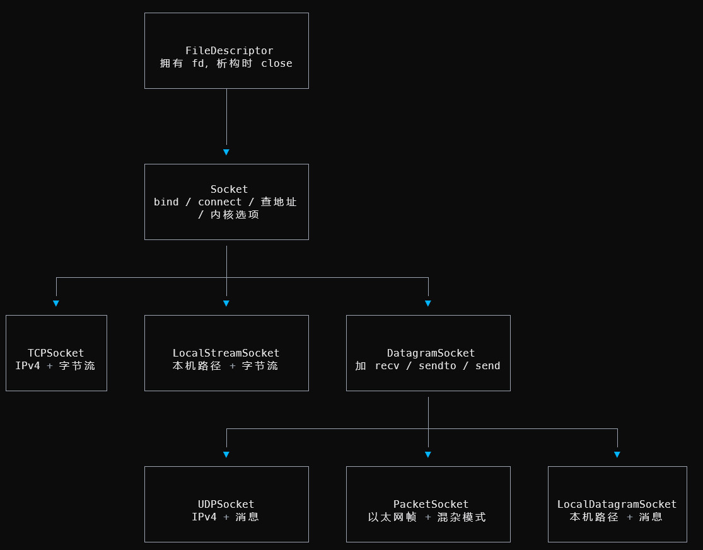

# 1.在linux环境中配置相关环境
要求Ubuntu，本机使用wsl2
运行以下命令即可：
```bash
sudo apt update && sudo apt install git cmake gdb build-essential clang clang-tidy clang-format gcc-doc pkg-config glibc-doc tcpdump tshark
```

# 2.字节流测试
访问http://cs144.keithw.org/hello，结果是Hello, CS144!
shell中运行 telnet cs144.keithw.org http，结果如下：
```
> telnet cs144.keithw.org http
Trying 171.64.65.14...
Connected to cs144.keithw.org.
Escape character is '^]'.
```
这行命令通过telnet程序，和cs144网站的80端口建立了字节流
此后输入以下内容
```
GET /hello HTTP/1.1
Host: cs144.keithw.org
Connection: close

```
本机测试结果如下
```
HTTP/1.1 200 OK
Date: Mon, 05 Oct 2026 18:26:01 GMT
Server: Apache/2.4.66 (Ubuntu)
Last-Modified: Thu, 13 Dec 2018 15:45:29 GMT
ETag: "e-57ce9343a1840"
Accept-Ranges: bytes
Content-Length: 14
Connection: close
Content-Type: text/plain

Hello, CS144!
Connection closed by foreign host.
```

接下来要求我们按照同样的方式访问http://cs144.keithw.org/lab0/sunetid，但是目前这个header已经不存在了，跳过这个部分
通过字节流发送邮件需要我们ssh到斯坦福，也只能跳过

最后需要我们进行监听和连接，在一个终端中输入netcat -v -l -p 9090， 另一个终端中输入telnet localhost 9090，进而建立一次真实的TCP连接，在其中一个终端的输入也会在另一个终端中显示出来

# 3.实现一个小的网络程序
此处需要使用操作系统提供的TCP实现接口，完成一个能创建TCP双向字节流的程序，要求可以根据明文 HTTP 的 (host, path)返回其HTML中的内容，如./apps/webget cs144.keithw.org /hello 返回Hello, CS144!

这门课程的lab语言是现代C++(C++20)，课程要求使用智能指针，RAII等现代特性，确保代码正确且高效，课程提供了用于检查现代C++风格的编译命令cmake --build build --target tidy

课程提供的现代C++代码十分规范，学习价值很高

这部分的代码在./apps/utils/file_descriptor.* 和 socket.* 中，需要我们完善./apps/output/webget.cc

## 课程提供的代码解读

`file_descriptor.*` 中实现了文件描述符的抽象。
其中的 `FDWrapper` 类持有资源，包含内核文件描述符fd，描述符指向的文件被读写多少次，是否阻塞等信息；在具体的实现上删除了构造与拷贝函数，只在触发整个文件描述符的构造和拷贝函数时更改fd，并且使用封装的函数`CheckSystemCall`用来检查系统调用返回值并抛出对应错误
`FileDescriptor`类只有一个指向对应`FDWrapper`的`shared_ptr`，没有直接掌握fd，而只是作为一个行为接口，提供了对指针指向的fd对应文件读写和获取一些统计量的接口；实现上只允许移动赋值和移动构造，避免发生意料之外的拷贝操作，如果需要拷贝，则需要显式使用`duplicate`函数
在`socket.hh`中，给定了各种套接字类的接口，这些套接字类之间的关系如下

`socket`类是所有网络端点的共同基类，无法直接被实例化，只有通过设置其(domain,type,protocol)，才能够实例化它的一个子类。
domain参数决定地址采用哪种命名空间，是整个全球的IP端口，本机路径还是网卡;type 决定通信形态是字节流还是数据报；protocol指定采用的协议，填0时会根据前两项采用最适合的协议
socket类最重要的是提供了`connect`用于和对端进行连接，`bind`将这个socket和本机的一个端口建立联系，`shutdown`进行半关闭
`socket`的继承类`DatagramSocket`添加了消息语义，通过补充方法，可以在数据报通信时得知消息的地址信息，但是同样无法实例化
`UDPSocket`继承于`DatagramSocket`，domain采用全球IP端口`AF_INET`，type为数据报类型，protocol填0自动设置为UDP协议，进而可以实例化
而`TCPSocket`继承于`Socket`而不是`DatagramSocket`，因为`DatagramSocket`实际上实现的是数据报，而TCP协议需要的是稳定的字节流连接。`TCPSocket`采用全球IP端口`AF_INET`，type为字节流类型，protocol填0自动设置为TCP协议，进而可以实例化。通过`Socket`提供的`connect`方法进行三次握手建立双向连接，从而确定通信地址。通过`listen(backlog)`切换到监听模式，用于服务器监听客服端连接，建立一个大小为`backlog`的等待队列。使用`accept`方法从等待队列中阻塞取出一个，构造客户端方的`TCPSocket`并返回该`TCPSocket`
`Address`是地址类，可以通过传入域名+端口，经过DNS解析后构造；也可以直接用IP地址+端口构造

了解了课程给出的脚手架代码之后，我们就可以尝试实现webget的核心函数：get_URL了。

## 具体实现
首先我们将目标域名转换成地址类，规定使用http协议。此后定义本机的TCP套接字(此处无需bind，后续connect会自动为该TCP套接字分配端口)，将该套接字用connect方法与目标域名建立连接。此后按照telnet的格式，构造一个包含请求端口的请求字符串(注意换行是\r\n)，发送到目标域名。对于传回的数据，重复用read进行读取直到eof即可。

```cpp
void get_URL( const string& host, const string& path ) {
    cerr << "Function called: get_URL(" << host << ", " << path << ")\n";
//   cerr << "Warning: get_URL() has not been implemented yet.\n";
    const Address dst_addr = Address(host, "http");
    TCPSocket client_socket;
    client_socket.connect(dst_addr);
    const std::string request = "GET " + path + " HTTP/1.1\r\n"
                              "Host: " + host + "\r\n"
                              "Connection: close\r\n"
                              "\r\n";
    /*
    GET /hello HTTP/1.1
    Host: cs144.keithw.org
    Connection: close
    */
    client_socket.write(request);
    string response;
    while (!client_socket.eof()) {
        string buffer;
        client_socket.read(buffer);
        response += buffer;
    }
    cout << response;
}
```

# 4.实现字节流
接下来的要求是补全/src/byte_stream.cc，实现一个字节流
尽管字节流的大小是有限的，直到eof为止，字节流在任意时刻不知道接下来还有多少数据，要求实现在任意时刻能够处理无限长($2^{64}$字节)大小数据

有意思的是，课程提供的脚手架代码中，`ByteStream`的两个子类`Writer`和`Reader`直接通过`ByteStream`构造生成，实际上只用了一个`static_cast`强制转换指针。这是因为如果`Writer`和`Reader`如果不含变量成员，那么两者的方法会被放入.text中，内存布局和`ByteStream`完全一样，尽管从父类到继承类的强制转换是UB，但是由于内存布局一致，可以正常运行。对于一个`ByteStream`，它的`Writer/Reader`实际上是它的别名，不过通过这种被称为`静态类型视图`的trick，做到了零开销和返回引用，同时分离了`Writer`和`Reader`的能力

代码实现是trivial的此处采用`std::string`模拟即可

byte_stream.hh:
```cpp
class ByteStream {
public:
  explicit ByteStream(uint64_t capacity);

  // Helper functions (provided) to access the ByteStream's Reader and Writer
  // interfaces
  Reader &reader();
  const Reader &reader() const;
  Writer &writer();
  const Writer &writer() const;

  void set_error() {
    error_ = true;
  }; // Signal that the stream suffered an error.
  bool has_error() const { return error_; }; // Has the stream had an error?

protected:
  // Please add any additional state to the ByteStream here, and not to the
  // Writer and Reader interfaces.
  uint64_t capacity_, acc_push, acc_pop;
  std::string buffer_;// buffered = buffer_.size()
  bool over_;
  bool error_{};
};
```

byte_stream.cc
```cpp
ByteStream::ByteStream(uint64_t capacity) : capacity_(capacity), acc_push(0ULL), acc_pop(0ULL), buffer_(std::string{}), over_(0) {}

bool Writer::is_closed() const {
  return over_;
}

void Writer::push(string data) {
  uint64_t push_len = std::min(static_cast<uint64_t>(data.size()), available_capacity());
  buffer_ += data.substr(0, push_len);
  acc_push += push_len;
  (void)data;
  return;
}

void Writer::close() {
  over_ = 1;
}

uint64_t Writer::available_capacity() const {
  uint64_t available_ = capacity_ - static_cast<uint64_t>(buffer_.size());
  return available_;
}

uint64_t Writer::bytes_pushed() const {
  return acc_push;
}

bool Reader::is_finished() const {
    return (over_ && buffer_.empty());
}

uint64_t Reader::bytes_popped() const {
  return acc_pop;
}

string_view Reader::peek() const {
  return std::string_view(buffer_);
}

void Reader::pop(uint64_t len) {
  buffer_.erase(buffer_.begin(), buffer_.begin() + len);
  acc_pop += len;
}

uint64_t Reader::bytes_buffered() const {
  return buffer_.size();
}
```

运行以下命令即可进行评测

```bash
cmake -S . -B build        # 已配置过可跳过
cmake --build build        # 编译全部（增量，改一个文件只重编它）
cmake --build build --target check0   # checkpoint 0 全套：webget + byte_stream_*
```

结果如下：
```
Test project /home/katyusha/lesson/CS144/others/code/minnow/build
      Start  1: compile with bug-checkers
 1/10 Test  #1: compile with bug-checkers ........   Passed    0.16 sec
      Start  2: t_webget
 2/10 Test  #2: t_webget .........................   Passed    1.09 sec
      Start  3: byte_stream_basics
 3/10 Test  #3: byte_stream_basics ...............   Passed    0.01 sec
      Start  4: byte_stream_capacity
 4/10 Test  #4: byte_stream_capacity .............   Passed    0.01 sec
      Start  5: byte_stream_one_write
 5/10 Test  #5: byte_stream_one_write ............   Passed    0.01 sec
      Start  6: byte_stream_two_writes
 6/10 Test  #6: byte_stream_two_writes ...........   Passed    0.01 sec
      Start  7: byte_stream_many_writes
 7/10 Test  #7: byte_stream_many_writes ..........   Passed    0.04 sec
      Start  8: byte_stream_stress_test
 8/10 Test  #8: byte_stream_stress_test ..........   Passed    0.02 sec
      Start 37: compile with optimization
 9/10 Test #37: compile with optimization ........   Passed    0.09 sec
      Start 38: byte_stream_speed_test
             ByteStream throughput: 5.32 Gbit/s
10/10 Test #38: byte_stream_speed_test ...........   Passed    0.08 sec

100% tests passed, 0 tests failed out of 10

Total Test time (real) =   1.52 sec
Built target check0
```

有趣的是，课程提到取决于电脑性能，吞吐量可能做到`10 Gbit/s`，我们的代码还可以进一步优化
目前性能瓶颈在于`pop`函数中，当发生一次头部删除时，后方所有元素都需要向前进行拷贝，最坏复杂度是整个缓冲区大小，实际测试中较快是因为`erase`底层采用了`memmove`，使用指令集SIMD进行数据搬运
一个优化算法如下：每次删除头部的时候，使用惰性删除，只更新头部已经被删除的死字节数。当死字节数大于活字节数时，在进行`erase`释放，均摊复杂度为`O(1)`，证明如下：

```
 设 Φ = popped_（死字节）：

 - 每次 pop：实际代价 O(1)，Φ mathrel+= len
 - 触发压缩的那次 pop：实际代价 = live ≤ dead = Φ（因为触发条件就是 dead ≥ live），随后 Φ ← 0

 于是对任意操作序列：

 ∑ 实际代价  ≤  ∑ len + Φ₀  =  N + O(capacity)
```

我们可以写出更改后的实现：
```cpp
ByteStream::ByteStream(uint64_t capacity) : capacity_(capacity), acc_push(0ULL), acc_pop(0ULL), poped_(0ULL), buffer_(std::string{}), over_(0) {}

bool Writer::is_closed() const {
  return over_;
}

void Writer::push(string data) {
  uint64_t push_len = std::min(static_cast<uint64_t>(data.size()), available_capacity());
  buffer_ += data.substr(0, push_len);
  acc_push += push_len;
  (void)data;
  return;
}

void Writer::close() {
  over_ = 1;
}

uint64_t Writer::available_capacity() const {
  uint64_t available_ = capacity_ - (static_cast<uint64_t>(buffer_.size()) - poped_);
  return available_;
}

uint64_t Writer::bytes_pushed() const {
  return acc_push;
}

bool Reader::is_finished() const {
    return (over_ && (bytes_buffered() == 0ULL));
}

uint64_t Reader::bytes_popped() const {
  return acc_pop;
}

string_view Reader::peek() const {
  return std::string_view(buffer_).substr(poped_);
}

void Reader::pop(uint64_t len) {
  poped_ += len;acc_pop += len; 
  if (poped_ * 2ULL >= static_cast <uint64_t>(buffer_.size())) {
    buffer_.erase(0, poped_); poped_ = 0;
  }
}

uint64_t Reader::bytes_buffered() const {
  return static_cast<uint64_t>(buffer_.size()) - poped_;
}
```
最后测试结果，吞吐量如下
```
ByteStream throughput: 14.24 Gbit/s
```
