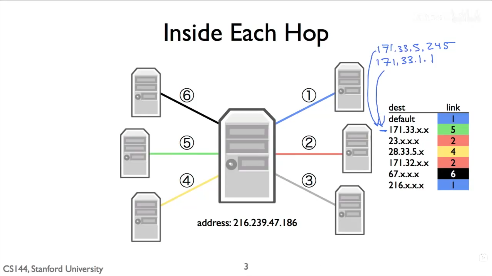

# Longest prefix match (LPM)

> 核心规则：路由器先找出**所有**能匹配目的 IP 的路由，再选择前缀长度最大的那一条。前缀越长，描述的地址范围越小，规则也就越具体。

当一个 IP 数据报到达路由器时，路由器不需要知道里面是 TCP、HTTP 还是别的 payload；它只读取**目的 IP 地址**，在当前转发表中查出应该从哪个接口、交给哪个下一跳。



## 1. 一条路由究竟匹配什么

一条 CIDR 路由可写成：

```text
网络前缀/前缀长度  →  下一跳或出接口
171.0.0.0/10       →  link 4
```

`/10` 表示只比较地址从左开始的前 10 个二进制位。设目的地址为 `d`，表项前缀为 `p`，长度为 `n`，其掩码为 `mask_n`，则命中条件是：

```text
(d & mask_n) == (p & mask_n)
```

这不是比较点分十进制数值是否接近，也不能只比较完整的八位组。例如 `/10` 会比较第一段的 8 bit 和第二段的前 2 bit；`171.0.0.0/10` 覆盖的第二段是 `0--63`。

## 2. 为什么要选“最长”

同一个目的地址可以同时落在多个地址块中：

```text
0.0.0.0/0       # 所有地址
171.0.0.0/8     # 所有 171.*.*.*
171.0.0.0/10    # 其中第二段为 0--63 的部分
```

目的地址 `171.15.15.0` 三项都命中，但 `/10` 固定了更多高位、覆盖范围最小，因此选择 `/10` 对应的 `link 4`。换言之，LPM 的正确性条件是：**只从命中项中选，并在这些项中取最大的 `n`**；不能按表项出现顺序、链路编号或地址数值大小来选。

`0.0.0.0/0` 的掩码全为 0，不比较任何地址位，所以一定命中。它是默认路由，只在没有更具体规则时承担兜底；若表中连默认路由都没有且没有其他匹配项，路由器会丢弃该数据报。

## 3. 图中的五个地址

| 目的地址 | 最长命中项 | 结果 |
| --- | --- | --- |
| `63.19.5.3` | `63.19.5.0/30` | link 3 |
| `171.15.15.0` | `171.0.0.0/10` | link 4 |
| `63.19.5.32` | 仅 `0.0.0.0/0` | link 1 |
| `44.199.230.1` | 仅 `0.0.0.0/0` | link 1 |
| `171.128.16.0` | `171.0.0.0/8` | link 2 |

两个容易错的边界：

- `63.19.5.0/30` 的最后 2 bit 可变，只覆盖 `63.19.5.0` 到 `63.19.5.3`；所以 `.3` 命中，而 `.32` 不命中。
- `171.128.16.0` 虽然属于 `171.0.0.0/8`，但第二段 `128` 不在 `/10` 的 `0--63` 范围内，故不能走 link 4。

## 4. 实现时的不变量

最直接的实现是线性扫描转发表：对每个命中项，若其 `prefix_length` 比当前最佳项更大，就替换当前最佳项。扫描到第 `i` 个表项后，应始终保持：当前保存的是前 `i` 项中前缀最长的匹配项。扫描结束后，它自然就是全表的 LPM 结果。

`/0` 和 `/32` 是实现边界：前者不比较任何 bit，后者必须 32 bit 全相同。不要用对 32 位整数左移 32 位的方式构造 `/0` 掩码，这在 C/C++ 中是未定义行为。

## 课程材料依据

- **R064**：AIGC *1-10 Longest prefix match (LPM)*，PDF 第 3--10 页给出候选集合、`(d & mask) == (p & mask)`、默认路由和线性扫描不变量；第 15--16 页使用本页同一张练习表说明 `/30`、`/10` 和默认路由。
- **R007**：官方 *Checkpoint 6: building an IP router*，第 3--4 页：匹配是比较目的地址与路由前缀的最高 `prefix_length` 位；在匹配项中选择最大的 `prefix_length`，无匹配则丢弃。
- **R032**：官方 *Routing slides*，第 1 页将路由表定义为“告诉计算机把包送往目的地”的状态。它侧重路由表的生成方法，与上述数据面 LPM 规则没有冲突。
