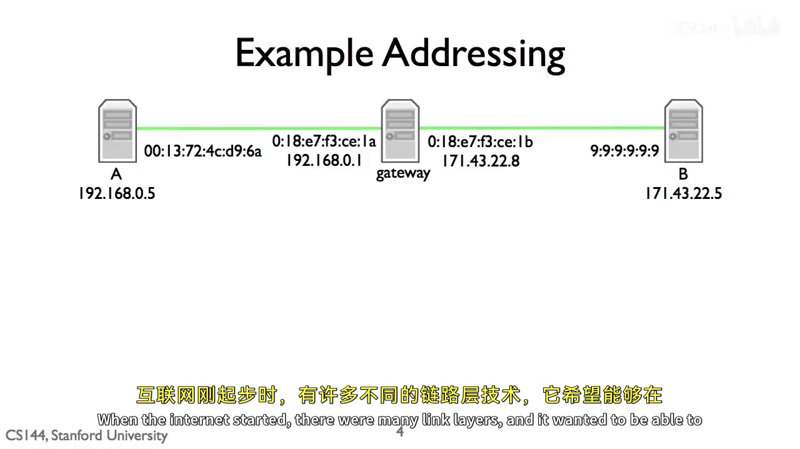
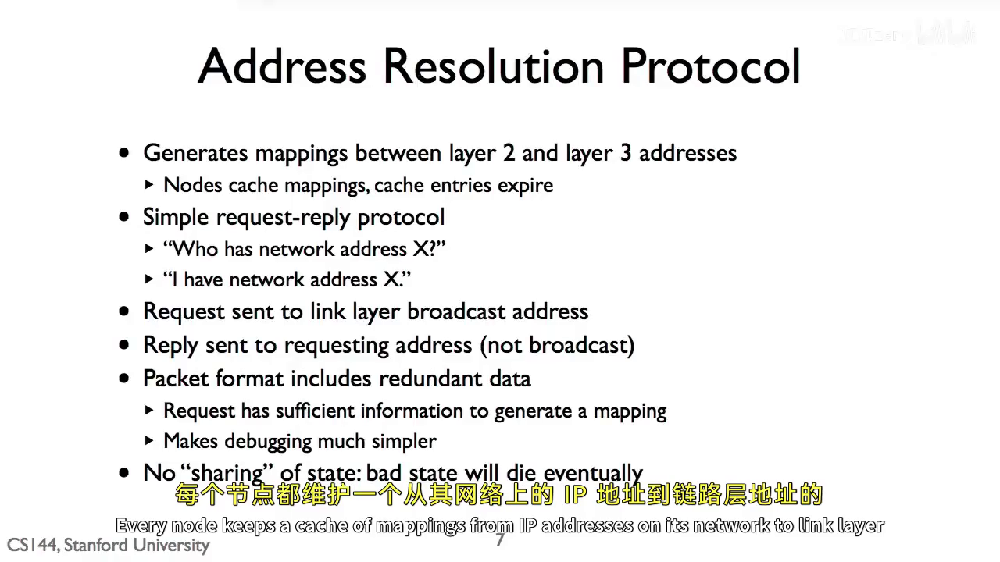
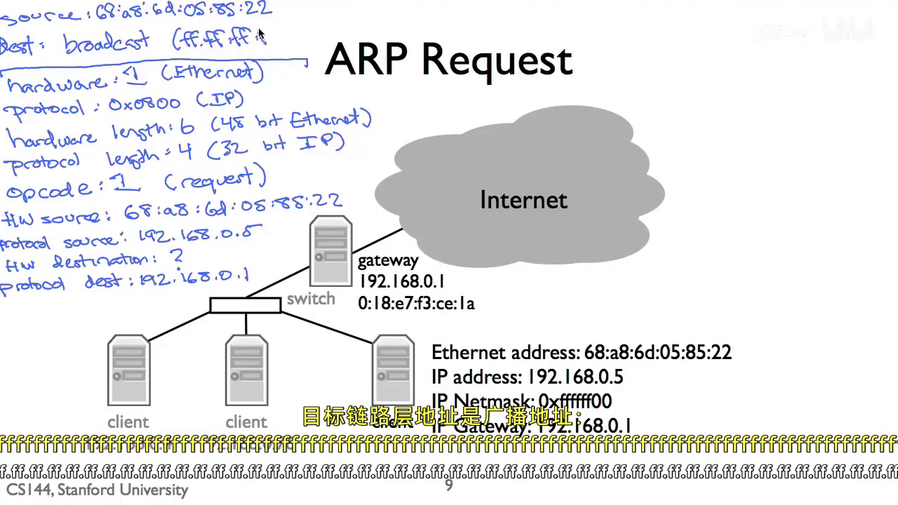

# 地址解析协议（ARP）：知道下一跳 IP 后，怎样真正把帧发出去

> 目标：理解 ARP 解决的具体问题、一次请求—应答怎样发生，以及为什么它只在本地网络中工作。
>
> 课程主线：AIGC 讲义 R110（*1-11 Address Resolution Protocol (ARP)*）；官方交叉核对：R006 第 1、3--4 页。

## 1. ARP 到底解决什么问题

主机准备发送数据时，往往已经知道 IP 数据报的最终目的地址，也已经由路由决定第一跳要交给谁；但以太网卡真正发送的是 **Ethernet 帧**，帧头还必须写入接收方的 **MAC 地址**。

因此，ARP 的任务可以概括成一句话：

```text
已知下一跳的 IP 地址 → 找到当前局域网内下一跳网卡的 MAC 地址
```

这里有两个容易混淆的角色：

- **IP 地址**：描述数据报最终要去哪里，用于跨网络选路。
- **MAC 地址**：描述当前这一跳要把以太网帧交给哪块网卡。

ARP 只做二者之间的本地映射；它不负责决定路线，也不负责把域名变成 IP。

## 2. 先选“下一跳”，再由 ARP 查 MAC

设 A 要把数据发给远端 B：

```text
A：IP 192.168.0.5
网关左接口：IP 192.168.0.1
B：IP 171.43.22.5
```



A 根据自己的子网掩码发现 B 不在本地网络，于是作出第一个决定：**第一跳交给网关 `192.168.0.1`**。

但 A 还不能立即发送。它知道网关的 IP，却不知道网关左侧网卡的 MAC；这正是 ARP 要补上的信息。

若缓存中已有映射，例如：

```text
192.168.0.1  →  01:8E:7F:3C:E1:1A
```

那么 A 可以直接构造第一跳帧：

| 层次 | 源地址 | 目的地址 |
| --- | --- | --- |
| IP 数据报 | `192.168.0.5` | `171.43.22.5`（最终目的 B） |
| 第一跳 Ethernet 帧 | A 的 MAC | 网关左接口的 MAC |

网关收到帧后，取出其中的 IP 数据报，继续查路由，并在右侧链路重新封装一个新帧交给 B。于是 IP 数据报仍然朝 B 前进，而 MAC 地址只服务当前这一跳。

> 不要把“最终目的 IP”和“本跳目的 MAC”当作同一个对象。访问外网时，第一跳 MAC 通常是默认网关的 MAC，不是远端服务器的 MAC。

## 3. 缓存未命中时：广播问，目标回答

若 A 的 ARP 缓存没有 `192.168.0.1` 的记录，A 就发送一个 ARP 请求。它的意思很朴素：

```text
谁拥有 IP 地址 192.168.0.1？
请告诉我；我是 192.168.0.5，我的 MAC 是 A 的 MAC。
```



### 第一步：ARP 请求是广播

A 不知道网关 MAC，自然无法指定某一块网卡。因此它把外层以太网帧的目的 MAC 写为：

```text
FF:FF:FF:FF:FF:FF
```

这是以太网广播地址，当前局域网内的设备都会收到这条请求。请求中同时带有：

- A 自己的 IP 与 MAC；
- 希望查询的目标 IP：`192.168.0.1`；
- 目标 MAC：尚未知，等待对方给出答案。



### 第二步：拥有该 IP 的网关回复

只有 IP 恰好为 `192.168.0.1` 的网关左接口需要响应。它会单独回复 A：

```text
192.168.0.1 在这里；我的 MAC 是 01:8E:7F:3C:E1:1A。
```

这次已经知道 A 的 MAC，因此回复可以直接交给 A，而无需再次广播。

### 第三步：写入缓存，再发送等待的数据报

A 收到回复后把结果写入 ARP 缓存：

```text
192.168.0.1  →  01:8E:7F:3C:E1:1A
```

此前等待发送的 IP 数据报现在就能被封装为目的 MAC 为网关的 Ethernet 帧并发出。之后 A 再经由同一网关发送数据时，可以直接命中缓存，不必每次都广播。

## 4. 为什么请求中还要写上 A 自己的地址

ARP 请求一边询问目标地址，一边附带发送者自己的 IP 和 MAC。这些看似“多余”的字段很有用：局域网中所有收到广播的节点都能顺便学习或刷新一条映射：

```text
192.168.0.5  →  A 的 MAC
```

因此每台机器都独立维护自己的 ARP 缓存，不需要一台中心服务器保存全网地址簿。这种缓存是“软状态”：它会在一段时间后过期。设备离线、网卡更换或地址重新分配时，旧记录最终会自然消失；下次要发送时重新 ARP 即可获得新映射。

## 5. ARP 的作用范围

ARP 请求只在当前本地网络内广播，路由器不会把它转发到 Internet。故 ARP 查的是：

```text
当前链路的下一跳 IP  →  当前链路的下一跳 MAC
```

它不是：

```text
任意远端服务器 IP  →  该服务器的 MAC
```

如果 B 与 A 同一子网，下一跳就是 B，A 会 ARP 查询 B 的 MAC；如果 B 不在同一子网，下一跳是网关，A 查询的是网关 MAC。每经过一个路由器，下一条链路都会按同样的思路解析自己的下一跳。

## 6. 把整个过程记成一条链

```text
应用交出数据
    ↓
IP / 路由：最终目的在哪？第一跳该交给谁？
    ↓
ARP：这个下一跳 IP 对应哪个本地 MAC？
    ↓
Ethernet：把帧交给该 MAC 所在的网卡
    ↓
路由器：取出 IP 数据报，选择下一跳，重新封装下一跳帧
```

可以把 IP 看成包裹的最终收件地址，把 MAC 看成当前中转站应交给的窗口。ARP 就是当你已知道“该去哪个中转站”，却不知道“该窗口编号”时进行的一次本地询问。

## 课程材料依据

- **R110**：AIGC *1-11 Address Resolution Protocol (ARP)*。`00:03:27--00:05:04` 展示 A 经网关到 B 时 IP 地址与逐跳 MAC 的区别；`00:05:04--00:06:55` 说明 ARP 缓存、广播请求、应答和软状态；`00:07:30--00:10:23` 给出请求、广播地址与应答字段的完整例子。
- **R006**：官方 *Checkpoint 5: down the stack to the network interface*。第 1、3--4 页将网络接口定义为 IP 数据报与单跳 Ethernet 帧之间的转换，并核对了“按下一跳 IP 缓存/查询 Ethernet 地址、未知时广播并暂存数据报”的流程。与 R110 的解释一致。
