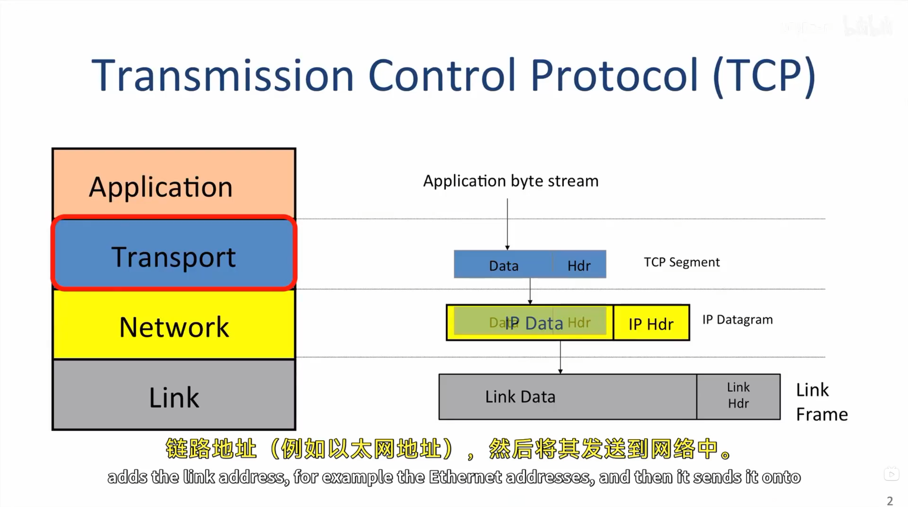
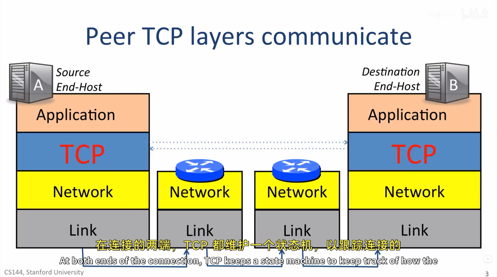
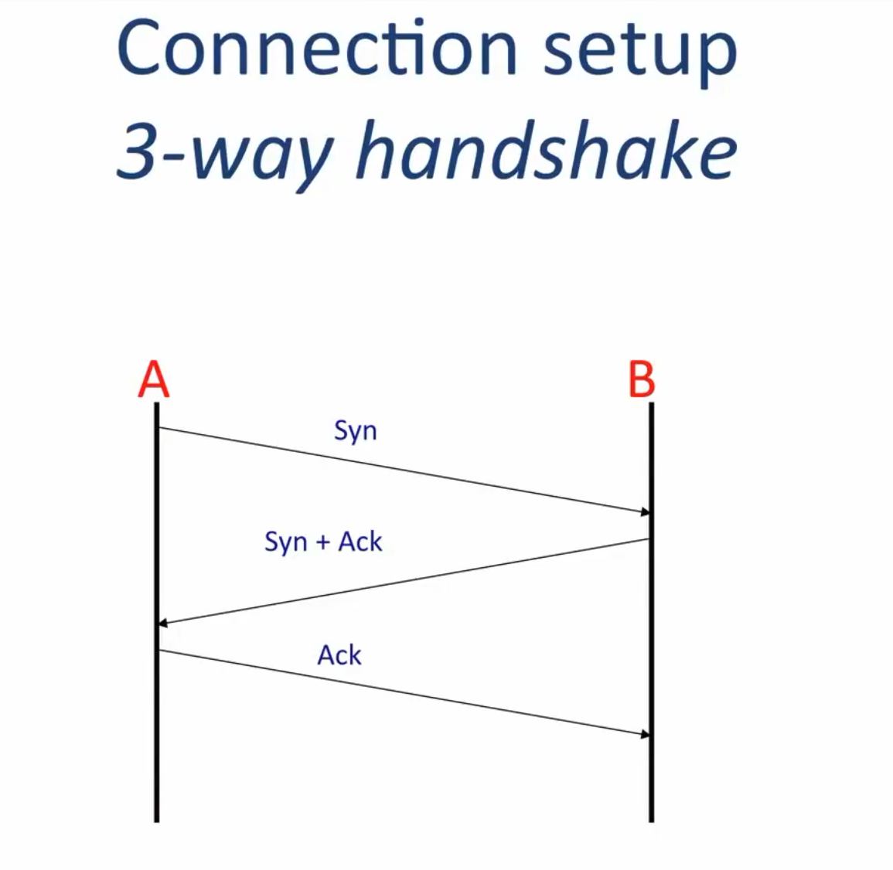

# TCP service model：在不可靠网络上提供可靠字节流

> 目标：理解 TCP 给应用提供什么服务，以及序号、确认和连接建立分别解决什么问题。
>
> 课程主线：AIGC 讲义 R113（*2-1 TCP service model*）；官方交叉核对：R039 第 2--8 页。

## 1. TCP 在分层中的位置



应用不会直接发送 IP 数据报，而是把一串字节交给 TCP。TCP 给这些字节加上 TCP 首部，形成 **TCP 段**；IP 再把它封装为 **IP 数据报**；链路层最终将它装入 Ethernet 等 **链路帧**并发给下一跳。

```text
应用字节流 → TCP 段 → IP 数据报 → 链路帧
```

IP 数据报可能丢失、重复或乱序到达。TCP 的目标是让两端应用仍像在读写一根可靠的、按序的双向字节流：内容不变、不重复、顺序不变。应用调用 `write()` 成功，只表示字节进入本机 TCP 的发送路径，并不表示远端应用已经读到它。

## 2. 真正通信的是两端 TCP 状态机



TCP 连接不是一根固定的物理管线，而是 A、B 两端内核各自维护的一份对应状态：端口、两个方向的序号、确认进度、接收窗口和连接阶段。中间路由器只转发 IP 数据报，并不维护这条 TCP 连接的完整状态。

一条连接可看成两条独立字节流：

```text
A ──字节流──> B
A <──字节流── B
```

所以 A 和 B 可以同时发送数据；“双向”不等于两个方向共用一套字节编号。

## 3. 三次握手：先同步两端状态



建立连接时，A 先发送 `SYN`，B 回复 `SYN + ACK`，A 再回复 `ACK`。这三步让双方确认消息能够往返，并分别确定 A→B、B→A 两个方向的初始序列号。

`SYN` 本身占用一个序号位置，因此若 A 的初始序号为 `i`，B 会用 `ACK = i + 1` 表示“我已经收到你的 SYN，下一项期待 `i + 1`”。初始序号通常随机选择，这样网络中迟到的旧连接报文不容易被误认为新连接的数据。

## 4. 序列号和确认号：给字节流标位置

一个 TCP 段中不是有“两套序列号”，而是通常同时有：

- `SEQ`：**本段发送方向**中，第一个数据字节的位置；
- `ACK`：**反方向**中，已连续收到的位置之后，下一步期待的字节位置。

例如 A 发出 9 字节 `hello TCP`：

```text
A → B: SEQ = 1000, payload = "hello TCP"  # 覆盖 [1000, 1009)
B → A: ACK = 1009                         # 下一个需要 A 的字节是 1009
```

`ACK = 1009` 表示所有序号小于 1009 的 A→B 字节都已连续收到。这种确认是累积的。序号让接收端发现中间缺口、缓存乱序段、识别重传的重复数据，最后只按正确顺序交给应用；TCP 可靠的是带位置的**字节**，而不是“第几个包”。

TCP 首部中的端口负责找到正确的应用 socket；窗口通告接收端当前还能接收多少字节；校验和用于检测首部和数据是否被破坏。`PSH` 只是提示接收端尽快把已有字节交给应用，它不是一条应用消息的结束标志。

## 5. 关闭：两个方向分别结束

`FIN` 的含义是“我这个方向不会再发送新的应用字节”，而不是立即摧毁整个双向连接：

```text
A → B: FIN          # A→B 的字节流结束
B → A: ACK          # 确认收到 A 的结束标记；B 仍可继续发数据
B → A: FIN          # B→A 的字节流也结束
A → B: ACK          # A 确认 B 的 FIN
```

`FIN` 也占用一个序号位置，所以确认它时 `ACK` 要加 1。最后的 ACK 不是 A 在关闭后又发送应用数据，而是确认 B 的结束标记；两个方向都完成后，连接才算真正关闭。

## 课程材料依据

- **R113**：AIGC *2-1 TCP service model*。`00:00:09--00:00:48` 说明 TCP 的可靠双向字节流与逐层封装；`00:01:15--00:05:15` 展示三次握手和双向分别关闭；`00:10:15--00:12:15` 介绍序号、确认号、窗口和首部标志。
- **R039**：官方 *Idempotence and TCP*。第 2--4 页列出数据报可能丢失、重复、乱序及确认/重传/序号的作用；第 7--8 页明确 TCP 是每方向各一条字节流，序号标识段首字节，ACK 表示下一需要的字节，窗口表示还可接收的数量。与 R113 一致。

