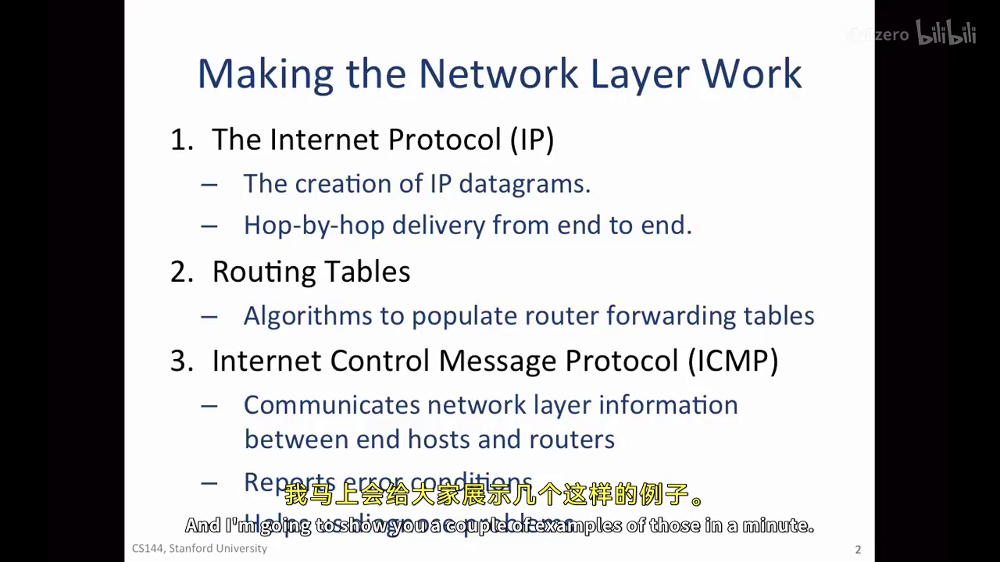
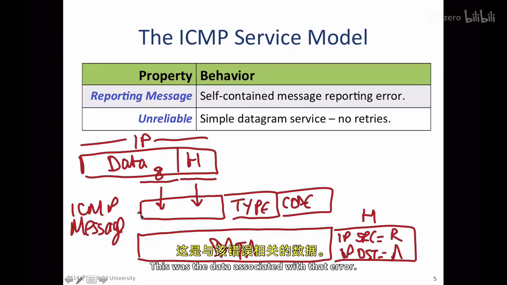
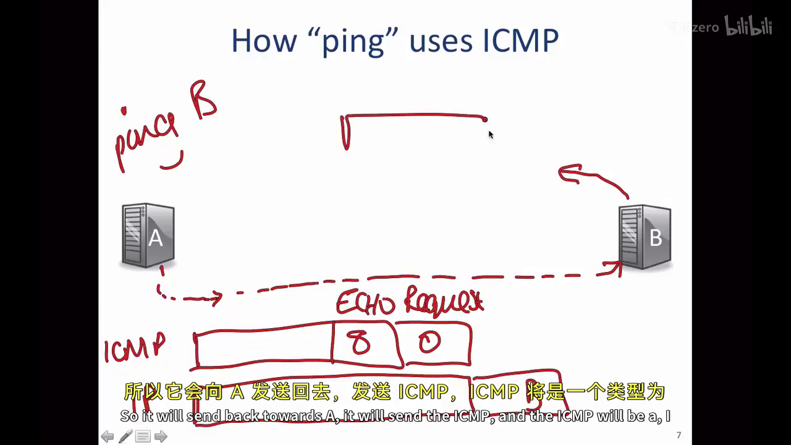
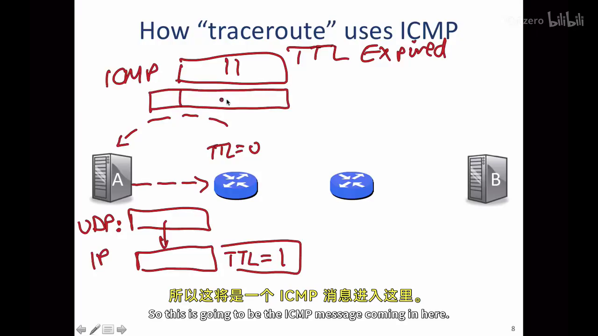

# ICMP 服务模型：网络出了问题，谁来把消息带回来？

> 目标：理解 ICMP 为什么存在、它能报告什么，以及 `ping` 和 `traceroute` 怎样利用它诊断网络。
>
> 课程主线：AIGC 讲义 R070（*2-3 ICMP service model*）；官方交叉核对：R028、R006、R007。

## 1. IP 尽力转发后，ICMP 负责反馈

IP 的职责是把数据报朝目的地逐跳转发，但它是“尽力而为”的：数据报可能丢失，路由器也可能不知道下一跳该往哪里走。此时如果发送者只等原数据报到达，就很难区分“还在路上”和“中途已经出错”。

**ICMP（Internet Control Message Protocol，互联网控制报文协议）**就是网络层的反馈通道。端主机或路由器观察到网络问题后，可以向原发送者回送一条说明，例如“目的网络不可达”或“TTL 已耗尽”。



这里的“可以”很重要：ICMP 报文本身同样由 IP 传输，也可能丢失、被防火墙过滤或被限速。它提供的是**诊断线索**，不是可靠确认，更不会自动重发原数据报。

## 2. ICMP 报文装在哪里？

ICMP 的内容被放进一个新的 IP 数据报中返回：

```text
触发问题的原 IP 数据报
          │
          ▼
路由器 / 目的主机生成 ICMP 报文
          │
          ▼
新的 IP 数据报，把 ICMP 送回原发送者
```

因此从封装关系看，ICMP 在 IP 的 payload 中；从功能看，它服务网络层的错误报告与诊断。官方 R028 也说明，IP 首部的 protocol 字段会让内核把 payload 分派给相应处理程序（如 `ping`、UDP）。

对于错误报告，经典 ICMP 格式会带回触发问题的**原 IP 首部和原 payload 的前 8 字节**。前者能指出原来的源/目的地址和上层协议，后者通常足以看到 UDP 或 TCP 首部开头的端口。这样源主机的内核才能把错误关联到正确的 socket。



## 3. type、code 和常见错误

`type` 表示问题大类，`code` 进一步区分原因，必须组合理解。R070 中的典型例子是：

| 含义 | type / code | 发生了什么 |
| --- | --- | --- |
| Network Unreachable | `3 / 0` | 某个路由器不知道怎样到达目的网络 |
| Echo Request | `8 / 0` | 请求对方原样回应，用于 `ping` |
| Echo Reply | `0 / 0` | 对 Echo Request 的回应 |
| Time Exceeded | `11 / *` | 数据报在转发途中 TTL 耗尽 |

“网络不可达”“主机不可达”和“端口不可达”并不相同：前两者说明路径较早就出问题；端口不可达则通常意味着数据报已经到达目标主机，只是没有程序在目标 UDP 端口接收它。

## 4. `ping`：最小的往返探测

运行 `ping B` 时，A 向 B 发送 `Echo Request (type=8, code=0)`；B 收到后返回 `Echo Reply (type=0, code=0)`。



若 A 在发送时记录 $t_s$，收到匹配回复时记录 $t_r$，则往返时间近似为：

$$
RTT=t_r-t_s
$$

它包含去程、回程、排队和端系统处理时间，不是单向传播时延。超时可能意味着丢包、ICMP 被过滤或限速，不能直接推出某个 TCP/UDP 应用不可用；反过来，ping 成功也只证明此时 ICMP 的往返路径可用。

## 5. `traceroute`：借 TTL 一跳一跳地观察路径

TTL（Time To Live）是 IP 首部中的跳数上限。每过一个路由器，它都会减一；减到零时，路由器丢弃该数据报。这个机制本来是为了防止路由环路让数据报无限转发，`traceroute` 则把它变成测量工具。

经典 UDP 版本的过程如下：

1. 发送 TTL=1 的 UDP 探测。第一台路由器把 TTL 减到零，返回 ICMP Time Exceeded；其回复源地址就是第一跳。
2. 把 TTL 增加到 2。探测穿过第一跳，在第二跳耗尽 TTL，于是得到第二跳。
3. 继续递增 TTL，就能逐步得到更远的响应路由器与每一轮 RTT。
4. 探测终于抵达 B 时，UDP 被送往一个故意选择的、无人监听的端口；B 返回 ICMP Port Unreachable，作为“已经到达目的地”的结束标记。



若第 $k$ 轮初始 TTL 为 $k$，数据报经过 $j$ 台路由器后：

$$
TTL_j=k-j
$$

当它变成 0 时，**当前这一跳**才产生 Time Exceeded；不是路径上每个路由器都为同一份探测回复一次。

实际输出中的 `*` 只表示该轮等待时间内没有收到回复，可能是丢包、过滤或限速；它不等于“这里没有路由器”。不同系统也可能用 ICMP Echo 或 TCP 而非 UDP 实现 traceroute，因此本节描述的是 R070 的经典 UDP 版本。

## 6. 一句话总结

> IP 负责尽力向前送；ICMP 负责把“这次转发观察到的问题”带回源端。`ping` 用回显报文测可达性和 RTT，`traceroute` 用逐步增大的 TTL 把每一跳的错误反馈变成路径观测。

## 课程材料依据

- **R070**：AIGC *2-3 ICMP service model*。`00:00:00--05:12` 说明 ICMP 的网络层反馈角色、经 IP 封装、type/code 与原数据报引用；`00:06:22--08:18` 说明 ping；`00:08:21--13:41` 说明基于 UDP 与 TTL 的经典 traceroute。
- **R028**：官方讲义第 26--27、125、137 行交叉核对 IP protocol 分用、ping 的 RTT/丢失观测，以及以不同 TTL 获取路径跳点的思路。
- **R006、R007**：官方 Checkpoint 5/6 材料说明现实网络可使用 ICMP 报告 host unreachable、无路由或 TTL 耗尽，但并非每台路由器都保证回复；这与 R070 的“诊断而非可靠通知”一致。
