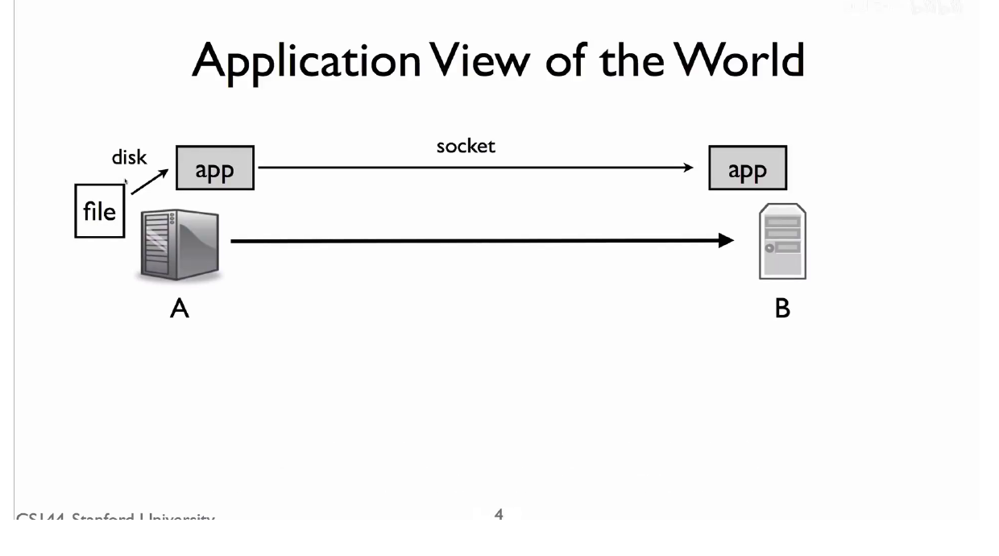
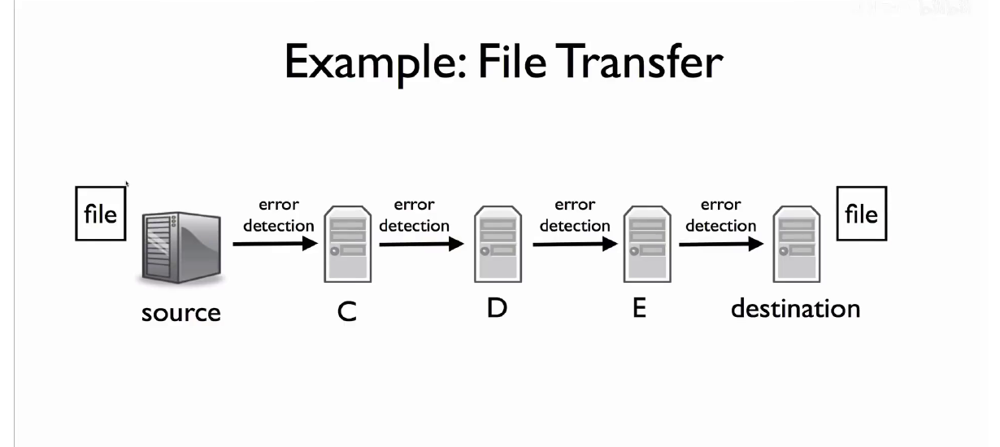
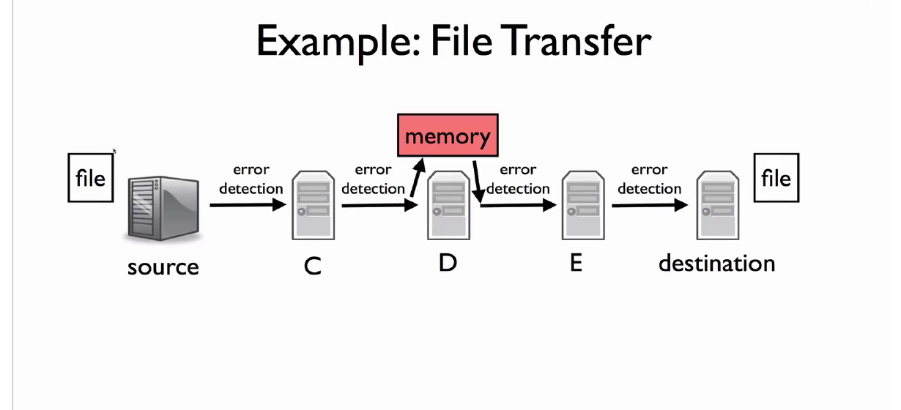

# 端到端原则：最终正确性由谁保证？

> 目标：区分端到端的**最终正确性**与每一跳的**局部检错/重传**，理解为什么它们不矛盾。
>
> 课程主线：AIGC 讲义 R116（*2-4 End to End Principle*）；交叉核对：官方 R028、R006。

## 1. 从一次文件传输开始

设 A 要把文件传给 B：A 的应用读出文件，将字节写入 socket；网络把多个数据包逐跳转发；B 的应用从 socket 读出字节并写成文件。



```text
源端应用 A ── 路由器 C ── 路由器 D ── 路由器 E ── 目的端应用 B
       端到端通信的两个端点：A 和 B
```

应用真正关心的不是“某台路由器转发过一个包”，而是：**B 最后得到的文件是否正是 A 要发送的那个文件。** 可以把它写成

$$
F_B = F_A.
$$

只有 A 知道原文件 $F_A$ 是什么，只有 B 知道最终写入并准备使用的 $F_B$ 是什么。因此，这个条件的最终检查必须由 A、B 参与。

> **端到端原则（正确性版本）**：如果一个功能要靠通信两端掌握的完整信息才能完全、正确地实现，它最终必须在两端实现。网络中间可以提供局部版本来加速，但不能取代端点的最终保证。

## 2. 路由器能做什么，不能做什么？

路由器并非什么都不做。它读取数据包的网络层首部，选择下一跳并转发；官方 R028 将 Internet 的服务描述为对数据报的 *best effort*，即尽力把数据报送向其最终地址。它通常不需要理解 payload（载荷）中“这是哪个文件、哪个版本、是否允许压缩或是否已安全写盘”。

因此路由器能说明的通常只是：

```text
“我把当前这个包交给了下一跳。”
```

而它不能替 B 说明：

```text
“整个文件已按正确顺序到齐，并被正确写入、通过业务校验。”
```

TCP 把丢失、乱序、重复等网络问题处理成两端看到的可靠有序字节流；但 TCP 仍不知道文件名、版本、权限或“转账只能执行一次”等业务语义。这些最终条件属于应用。

## 3. 图中的多处错误检测，为什么不违反端到端原则？

“两端”有两个不同的范围，不能混为一谈：

```text
端到端：             A ───────────────────────────── B
逐跳链路：          A—C       C—D       D—E       E—B
```

每条物理/链路层连接也有局部的两个端点。例如 C—D 这一跳的端点是 C 和 D；它们可用 Ethernet CRC 等机制检查“这一次在线上传输的帧有没有损坏”。坏帧被尽早丢弃，某些链路（如无线）还能在本地重传。



这很有用，因为错误在这一跳发生，就能以很短的反馈环修复，避免把坏数据继续占用后面的带宽，也避免 TCP 等待较长的端到端超时。

但单跳检错的保证范围只是：

```text
本次发送的帧 ──> 本跳接收的帧
```

它不覆盖整个 A 到 B 的路径，更不覆盖路由器内存、协议栈、B 的写盘和应用处理。故而“每一跳都检查过”不蕴含“最终文件一定正确”。

## 4. 为什么局部检查全部通过，文件仍可能错误？

一个典型反例是：D 从 C 收到帧并完成校验后，D 的内存恰好发生 bit flip；D 再向 E 发送时，链路层会针对**已经损坏的新内容**重新计算校验字段。于是 D—E 这一跳仍可能通过检查，B 收到的却已不是原文件。



```text
C → D：校验通过
       ↓ D 的内存随后损坏
D → E：为损坏后的数据重新生成校验，仍可能通过
       ↓
B：若没有端到端检查，可能把错误文件当作正常文件
```

这说明局部机制不是无效，而是覆盖范围有限。检查能证明什么，取决于它从哪里开始计算、到哪里完成验证。

## 5. TCP、文件 hash 与链路 CRC 各负责什么？

它们不是相互替代，而是在不同边界上提供不同能力：

| 机制 | 两端/范围 | 主要解决的问题 | 不能单独保证什么 |
| --- | --- | --- | --- |
| 链路 CRC / 局部 ACK | 一条链路的相邻节点 | 尽早发现这一跳的传输损坏，必要时局部重传 | 整条路径、最终文件、业务语义 |
| TCP 的序号、ACK、重传 | A 与 B 的 TCP 协议栈 | 丢失、重复、乱序，可靠有序字节流 | 文件版本、落盘成功、订单是否重复执行 |
| TLS 的认证完整性保护 | TLS 通信两端 | 防止传输中被未授权篡改，并保护机密性 | 业务操作本身是否符合规则 |
| 应用的文件 hash / 幂等键 / 事务 | 应用 A 与应用 B | 完整对象与业务不变量 | 不能替代底层的快速局部恢复 |

例如 BitTorrent 可为每个文件块保存预期 hash；B 收到后验证每一块。此时应用检查的是“这个块是否就是我要的内容”，而不仅是“某次网络传输看起来没坏”。若校验失败，应用再决定重取哪一块、回滚还是报错。

## 6. 原则不是“中间网络绝不能做事”

这是最常见的误解。端到端原则反对的是：把中间机制当作**唯一**的正确性保证；它并不反对中间层作为性能增强。

无线链路上的局部 ACK 和重传正是好例子：它能快速弥补无线一跳的丢帧，降低端到端 TCP 重传的等待时间。但无线设备无法知道 B 是否收到了整个文件，因此 TCP 的端到端可靠性机制仍要保留。

可以把职责概括为：

```text
局部机制：让常见错误更快、更便宜地恢复
端到端机制：保证最终需要成立的条件真的被检查
```

## 7. 对安全性和业务正确性的含义

“最终由端点保证”也不等于“只能由应用自己手写”。端点机制可以位于应用、TLS 库或操作系统 TCP 栈；关键在于它的验证范围是否跨越 A 到 B，并且是否拥有所需语义。

- 想保证字节流按序可靠到达：TCP 可在两端完成。
- 想保证通信内容保密且未被伪造：TLS 等端到端安全协议可在两端完成。
- 想保证“只扣款一次”“写入的是指定版本的文件”：应用必须用幂等键、版本号、hash、事务等业务状态完成最后判断。

所以设计网络系统时，应先写出真正要保证的不变量，再问：谁拥有判断它所需的全部状态？若答案是通信两端，中间层可以优化，但端点检查不能删除。

## 8. 与课程材料的对应关系

- R116 给出了文件传输、逐链路检错、路由器坏内存、TCP 与应用 hash、无线局部重传的主线，并明确区分正确性版本和更强调网络简洁/可演进性的强端到端原则。
- 官方 R028 佐证 Internet 数据报的 *best effort* 转发与封装边界：网络主要处理外层数据报，payload 的意义由端点处理。
- 官方 R006 佐证层次关系：TCP 段被封装进 IP 数据报，IP 数据报又在每一跳被封装进 Ethernet 帧；它区分了最终目的地和下一跳。

三份材料在上述职责边界上没有冲突。官方 Winter 2024 材料并未完整展开 Saltzer–Reed–Clark 的端到端论证，因此“坏内存反例”和强/弱原则的详细解释以 R116 为主。

## 带走三句话

1. A 与 B 是文件传输的端到端端点；每条链路也有局部端点，二者的范围不同。
2. 单跳检错和局部重传是在更近的位置快速修复错误，不是对整次通信的最终证明。
3. 先写最终不变量，再决定机制：TCP 管字节流，TLS 管通信安全，应用管文件和业务语义。
