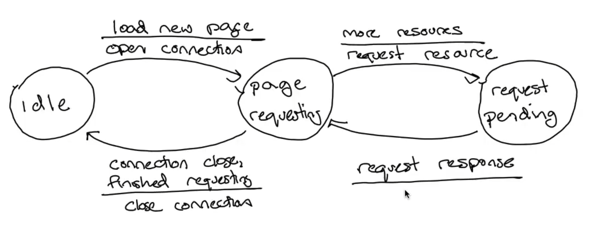

# 有限状态机：把协议写成可检查的事件规则

> 目标：掌握状态机的读法（状态、事件、动作、唯一转移、未定义转移），再沿 TCP 大图把三次握手推到不变量一级；关闭半区只记"谁在等什么"，转移细节留在 *2-11*。
>
> 课程主线：AIGC 讲义 R118（*2-6 Finite state machines*，P28–P31，约 12 分 55 秒）；建立部分按 R123（*2-11*）与官方 R026、RFC 9293 交叉核对。

## 1. 基本读法

有限状态机由有限数量的状态组成，其中状态指的是系统的一种特定配置。状态之间通过连接的边进行转换，一条边的信息包含**什么情况会导致这种转换**（事件）以及**系统对该转换对应的反应**（动作）。对于给定的状态，发生一个事件之后状态的转移必须是唯一的。

形式化写成 $M=(S,E,A,\delta,s_0)$，其中 $S$ 为有限状态集合，$E$ 为事件集合，$A$ 为动作集合，$s_0$ 为初始状态，转移函数

$$\delta(s,e)=(s',a)$$

同时回答两件事：进入哪个新状态 $s'$，以及此刻执行什么动作 $a$。

几条读图约定：

- 箭头是转移，**上方写事件，下方写动作**；动作可以省略，事件不可以省略。缺动作 = 规范不完整，实现者只能猜，测试也无法断言。
- **同一 (状态, 事件) 对至多一条边**，否则事件到来时规范无法决定走哪条。
- **没有定义边 ≠ "什么都不做"**：那是未定义行为。此时 $\delta$ 是部分函数 $\delta:S\times E\rightharpoonup S\times A$——若网络/应用/定时器仍可能产生该事件，就必须显式规定处理（丢弃、报错、复位），不能靠猜测。
- 一条边可以挂多个事件。

事件只有三类来源：**本地应用调用**（打开/关闭连接）、**报文到达**（某个标志位组合）、**定时器超时**。时间流逝本身不改变状态，必须有一个明确事件。

与操作系统的对照：进程的"运行/就绪/阻塞"由时钟中断和 I/O 完成驱动迁移，TCP 状态机由报文和应用调用驱动。区别是进程状态机描述单个内核对象，TCP 状态机描述**两个端点如何建立和释放通信关系**，一端的状态不能推断另一端。

## 2. 一个简单的 FSM 实例



这张图是一个 HTTP 客户端的玩具模型：`idle`（正在看页面或空闲）、`page requesting`（连接已开，正在决定还要取什么）、`request pending`（GET 已发出，等响应）。

| 当前状态 | 事件 | 动作 | 下一状态 |
|---|---|---|---|
| idle | load new page | open connection | page requesting |
| page requesting | more resources | request resource（HTTP GET） | request pending |
| request pending | request response | —（无动作） | page requesting |
| page requesting | connection close **或** finished requesting | close connection | idle |

自检：全系统只有 4 个事件，3 个状态，事件集合与状态集合的笛卡尔积是 12 格，而图里只定义了 4 格。例如"`request pending` 时连接被关""`page requesting` 时又点了新链接""`idle` 时收到响应"都没有边——这不是遗漏，而是需要作者表态的设计决策（加边，或写明该事件在此状态被丢弃/视为错误）。

同时要问这张图**藏了哪些前提**：是假定同时只有一个在途请求（即应用会排队）、假定 UI 禁止二次点击，还是假定不关心？以及超时和重传去了哪里——答案是把可靠性推给了下层 TCP。真实 HTTP 还涉及连接复用、消息边界、错误码，这张图只用来训练覆盖检查。

## 3. 读 TCP 大图：先分阶段，再追事件


图例（左上）：虚线箭头 = unusual event；红色 = client/receiver 路径；蓝色 = server/sender 路径。边写成 `事件/动作`，`-` 表示无动作（例如 `LISTEN/-`、`ACK/-`）；图中还直接标出了 `Step 1/2/3 of the 3-way handshake`（`CONNECT/SYN`、`SYN/SYN+ACK`、`SYN+ACK/ACK`）。下方两个虚线框分别是 **Active CLOSE** 与 **Passive CLOSE** 半区。图里 `CLOSED` 出现两次（起点和终点），所以框数比状态数多一个；完整状态机首先被压缩成

$$\text{closed}\rightarrow\text{opening}\rightarrow\text{established}\rightarrow\text{closing}\rightarrow\text{closed}.$$

按半区记：建立半区 = CLOSED / LISTEN / SYN-SENT / SYN-RECEIVED（+ ESTABLISHED）；关闭半区 = FIN-WAIT-1 / FIN-WAIT-2 / CLOSE-WAIT / CLOSING / LAST-ACK / TIME-WAIT。

读图算法：先定起点，维护二元组 $(s_i,e_i)$，每跨一条边同时记录"本地动作"和"新状态"，得到 $(s_{i+1},a_i)$，直到事件序列耗尽。**不要只沿视觉上最粗的一条路径跳**。

## 4. 建立半区：三次握手逐边推演

### 4.1 状态迁移

| 当前状态 | 事件 | 动作 | 下一状态 |
|---|---|---|---|
| CLOSED | 应用 `connect`（主动打开） | 发 SYN(seq=C) | SYN-SENT |
| CLOSED | 应用 `listen`（被动打开） | 进入监听 | LISTEN |
| LISTEN | 收到合法 SYN | 创建/关联连接控制块、记录对端起点、选本端起点、发 SYN-ACK(seq=S, ack=C+1) | SYN-RECEIVED |
| SYN-SENT | 收到 SYN+ACK | 发 ACK(seq=C+1, ack=S+1) | ESTABLISHED |
| SYN-RECEIVED | 收到 ACK | — | ESTABLISHED |
| SYN-SENT | 收到 RST | 通知应用连接失败 | CLOSED |

注意箭头上的"一次报文传送"是简化写法：真实两端在**不同时刻**各自迁移。

### 4.2 每条消息改变了谁的知识

| 时刻 | 客户端确信 | 服务器确信 |
|---|---|---|
| 发完 SYN | 只知道自己的起点 C | 无 |
| 收到 SYN+ACK | C 已到达对方；对方起点 S | 收到 C；自己已发出 S（**不知道 S 是否到达**） |
| 收到 ACK | 无新增 | S 已到达对方 → 建立完成 |

关键推论：**客户端在第 2 步之后就已经完成**，第 3 条消息纯粹是把服务器从"半确信"推到"确信"。所以在最终 ACK 抵达服务器之前，两端并**不同时**处于 ESTABLISHED——分布式系统没有一次更新双方状态的共享内存操作。把客户端状态集与服务器状态集做笛卡尔积，再叠上"网络中正在传输的报文"，才是完整全局状态。

### 4.3 为什么是三条，不是两条

- 只到第 2 步就认定建立，服务器无法区分"我的 SYN+ACK 丢了"和"连接已建立"——它没有任何证据自己的回复到达了对方。
- RFC 9293 §3.5 的原话：*"The principal reason for the three-way handshake is to prevent old duplicate connection initiations from causing confusion."* 一个旧连接的重复 SYN 若能让服务器单方面进入建立态，就会留下客户端从未同意的半开连接；第 3 条的 `ack = S+1` 必须引用**当前化身**的 ISN，旧报文猜不出来。
- 反向也成立：两个 SYN 交叉的**同时打开**是合法路径，实际表现为四条消息。R026 明确写着"这不是经典三次握手，但仍是合法的建立方式"。合法性由标志位与序号关系决定，不由"第几个包"决定。

### 4.4 序号账本

三条不变量（R123、R026、R039）：

- `ACK` 是**下一个需要的字节位置**，不是"最后收到的字节"，所以确认 SYN 要 +1。
- **SYN 与 FIN 各占一个序号位置**，即使载荷为 0：`next = seq + payload_len + SYN + FIN`。
- 段的 `SEQ` 属于本方向，`ACK` 属于反方向，两套编号空间没有大小关系。

澄清（对应首部图）：**"占一个序号位置" ≠ "占负载一个字节"**。SYN/FIN 是首部 flag 字节里的比特，上线 0 字节；"占位"指接收方账本游标前进一格。首部（含 MSS/WS/SACK/TS 等选项）不占序号空间，故握手段"0 负载"≠"空段"；纯 ACK 消耗 0 格，其后的数据段沿用同一 `seq`（RFC 9293 §3.5 Figure 6）。握手段允许携带数据（同上；TFO/RFC 7413 允许 SYN 与 SYN-ACK 带数据）。推演见 `others/qa-log/2026-10-05-handshake-SA-SP.md`。

用 R026 的原例走一遍：

```text
I    → Peer : seq = 12340, SYN=1, data = "abcdef", FIN=1
Peer → I    : ack = 12348      # 12340(SYN) + 6 字节 + 12347(FIN) → 下一个要 12348
Peer → I    : seq = 9999, SYN=1, data = "", FIN=1
I    → Peer : ack = 10001      # 9999(SYN) + 10000(FIN)
```

握手的第 3 段是零长度控制段：`seq = C+1`（位置 C 已被自己的 SYN 占用），`ack = S+1`。

### 4.5 三条消息各丢一次

| 丢失 | 后果 | 收敛方式 |
|---|---|---|
| SYN | 客户端停在 SYN-SENT | 超时重传**同一逻辑 SYN**（不消耗新序号），服务器视角与首次到达相同 |
| SYN+ACK | 服务器停在 SYN-RECEIVED | 服务器重传；客户端可能同时重传 SYN，服务器必须识别为同一次建立尝试并给出一致响应，**不能创建第二个控制块** |
| ACK | 客户端已 ESTABLISHED，服务器仍在 SYN-RECEIVED | 服务器重传 SYN+ACK 逼出 ACK；或客户端数据段携带的 `ack = S+1` 直接推进服务器 |

一般化的幂等性要求：`apply(apply(S,m),m) = apply(S,m)`——同一控制消息重复到达不得重复推进协议可观察状态（允许再次产生 ACK 这类帮助对端收敛的输出）。这也是"超时只说明期限内没观察到进展，不证明对端状态"的直接理由。

### 4.6 为什么初始序号随机

R026 的逻辑：ISN 随机 + SYN 置位 ⇒ 收方判定"这个序号在旧流里根本不成立，且 SYN=1" → 这是连接的**新化身**，从而把旧化身的延迟副本挡在外面；同时让序号不可预测，抬高伪造成本。随机化**不是**认证，防伪造要靠加密或 PAWS 一类机制。

### 4.7 实现要点

- `LISTEN` 收到合法 SYN 是一个**复合动作**：创建/关联控制块、记录对端 ISN、选本端 ISN、发 SYN-ACK、进入 SYN-RECEIVED；其中任何一步重传都不得重复向应用报告新连接。
- 状态枚举不是全部状态：连接还要保存收发序号、窗口、重传队列和计时器，两个同处 ESTABLISHED 的连接可以有完全不同的可接受序号范围。
- 与系统调用的对应：`connect` 触发主动打开；`listen`/`accept` 分离"监听"与"取走一条已完成连接"；`close` 只减少引用并请求释放，不保证网络上立刻没有状态。

## 5. 关闭半区：只记义务，不展开

判断关闭状态不必背图，问四个问题即可：**本端发过 FIN 吗？对方确认了吗？对方发过 FIN 吗？本端确认了吗？**

| 状态 | 在等什么 |
|---|---|
| FIN-WAIT-1 | 自己 FIN 的确认（若先收到对方 FIN 而自己 FIN 未被确认，则进 CLOSING） |
| FIN-WAIT-2 | 对方的 FIN（自己的发送方向已被确认关闭，仍可接收数据） |
| CLOSE-WAIT | 本地应用决定关闭（远端 FIN 已收到并确认） |
| CLOSING | 自己 FIN 的确认（两个 FIN 交叉的结果） |
| LAST-ACK | 自己 FIN 的最终确认 |
| TIME-WAIT | 2×MSL 计时结束（隔离期，用于处理延迟报文与重传的 FIN） |

- 全双工：`close(A→B) ⇏ close(B→A)`。FIN 是序号空间中的**有序终止标记**，不是"立即释放状态"的命令；一方的 FIN 之后，另一方仍可继续发送，主动方必须继续接收并交付。
- 被动关闭者的选择决定主动方停在哪里：只 ACK 不关（半关闭）→ 主动方停在 FIN-WAIT-2；也关 → 主动方经 TIME-WAIT 收尾；同时关 → 双方都走 CLOSING → TIME-WAIT。
- TIME-WAIT 是"最后 ACK 可能丢失"的兜底：对方重传 FIN 时，主动方必须还能重发 ACK 并重启计时。规范要求 2×MSL（MUST-13，MSL 取 2 分钟），实现常取 60 秒——**不变量是 2×MSL，具体秒数按实现**。
- 诊断线索：大量 CLOSE-WAIT 堆积通常是本地应用收到 EOF 后没关 socket；大量 FIN-WAIT-2 堆积则是本方 FIN 已确认而对端迟迟不结束发送方向。

各条边的完整转移、"被动方行为 × 主动方响应"矩阵、丢包推演见 R123（*2-11*）。

### 5.1 TIME-WAIT 展开

状态定义（RFC 9293 §3.3.2 原文）已把两个目的写在一句里：`"represents waiting for enough time to pass to be sure the remote TCP peer received the acknowledgment of its connection termination request AND to avoid new connections being impacted by delayed segments from previous connections."`

1. **可靠收尾**：最终 ACK 可能丢失。对端因此重传 FIN；只要本端仍在 TIME-WAIT，就还能再回 ACK，并**重启 2MSL 计时器**（RFC 9293 §3.10.7.4：`"TIME-WAIT STATE: Remain in the TIME-WAIT state. Restart the 2 MSL time-wait timeout."`）。若本端已删状态，重传的 FIN 会得到 **RST**，对端把一次正常关闭报成 `connection reset`。
2. **隔离旧化身**：延迟的旧段最长可在网络中存活 MSL；等 $2MSL$ 再允许同一四元组复用，旧段已全部离网。没有这一条，旧数据可能落进新连接的窗口被当成新连接自己的字节。
3. $2MSL$ 的拆分（讲义口径）：一个 MSL 覆盖旧 FIN/旧段的到达与再次确认，另一个 MSL 让最后 ACK 的副本离网。规范 MSL 取 2 分钟（RFC 9293：`"Arbitrarily defined to be 2 minutes"`，工程选择）；Linux 默认 `net.ipv4.tcp_fin_timeout = 60`（本机实测），故**不变量是 $2\times MSL$，具体秒数按实现**。
4. 规范条款：主动关闭方 `"MUST linger in the TIME-WAIT state for a time 2xMSL"`（MUST-13）；允许从 TIME-WAIT 直接接受新 SYN 重启连接（MAY-2，要求新 ISN 大于上一化身用过的最大值，且若该 SYN 是旧副本则退回 TIME-WAIT）；启用时间戳选项时有更好的算法（SHLD-4，见 RFC 7323 的 PAWS）。
5. 谁进入：**主动关闭方**。被动方走 LAST-ACK → CLOSED（收到最终 ACK 即结束，无需等待）；同时关闭则双方都进 TIME-WAIT。半关闭（对端只 ACK 不关）时主动方停在 FIN-WAIT-2，不占用 TIME-WAIT。
6. 成本与缓解：TIME-WAIT 占用 TCB 与四元组，高并发短连接会堆积。缓解靠连接复用（keep-alive）、扩大临时端口范围、受限的 `tcp_tw_reuse`（本机 `= 2`，仅回环；依赖时间戳），以及 `tcp_max_tw_buckets`；强制 RST / `SO_LINGER 0` 的代价是丢弃未确认数据并让对端看到 reset，不是通用捷径。诊断：`ss -tan state time-wait | wc -l`。

**$2MSL$ 通俗版**：MSL 就是"一个段在网络里最多能活多久"（规范拍成 2 分钟；真实网络里段只活毫秒到秒级）。**MSL 之后，可以认为这一个段已经不在了。** 注意：$2MSL$ **不是**"从 t=0 起算的一次性预算"，而是"**本端上一次发言之后的窗口**"——因为计时器在每次收到重复 FIN 时清零重启（§3.10.7.4）。

```text
t=0          A 发出最后的 ACK（假设丢失）
t=0..RTO     B 在等自己的重传定时器（这段等待与 MSL 无关）
t=RTO        B 重传 FIN（这封信自己也最多活 MSL）
t=RTO+δ      A 收到 ⇒ 再回 ACK ⇒ 计时器清零，重新开始算 2MSL
             （若 B 仍收不到，循环继续；A 每次收到都重新计时）
t=最后一次ACK + 2MSL                 A 才允许删除状态、允许复用四元组
```

- 因此"两个 MSL"算的是**网络侧的清场时间，不含对端的 RTO**：第 1 个 MSL 覆盖"我最后那个 ACK 的副本自身的寿命"，第 2 个 MSL 覆盖"若它没解决问题，对端重传的 FIN 走到我这里所需的网络延迟"。对端的定时器等待由**计时器重启**迭代吸收，不需要塞进这两个 MSL 里。
- 为什么不是 1 个：单个 MSL 只保证"一个段消失"，覆盖不了网络往返，也覆盖不了"在最后时刻才产生的那最后一个 ACK"。为什么不是 3 个：$t=2MSL$ 时往返已覆盖、旧物已清空，多等只增加端口占用。⇒ 2 是"刚好够"的最小网络侧窗口。
- 边界（诚实声明）：规范只给规则与两个目的，**没有**把对端 RTO 纳入的形式化证明；成立前提是 RTO 与 MSL 同量级。极端退避（RTO 长于 TIME-WAIT 窗口）理论上可让重传 FIN 落在本端删状态之后 ⇒ 本端回 RST、对端报 reset。Linux 的 RTO 退避上限（`TCP_RTO_MAX`，120 秒量级，按内核源码常量）与其 `tcp_fin_timeout = 60` 相比，正说明 $2MSL$ 是工程近似而非定理。
- 同一把尺子也用在别处（说明它是"清场单位"而非 TIME-WAIT 专属）：主机重启丢失序号记忆后要安静一个 MSL（RFC 9293 §3.4.3 quiet time）；ISN 由 32 位时钟生成、约 4.55 小时绕一圈，远长于 MSL，故同一四元组在 MSL 之后新建连接时 ISN 必然不同（§3.4.1）。规范也承认现代网络的有效 MSL 在下降（`"the effective MSL of the Internet has declined as links have become faster"`），这正是实现取更短秒数的理由。

## 6. 怎么验证状态机，而不是背状态名

1. **确定性**：同一状态同一事件不能产生两个不同结果。
2. **覆盖性**：列出报文事件、应用调用、定时器三类输入，确认所有可达组合都有定义。
3. **可达性**：从 $s_0$ 出发求最小不动点 $Reach(s_0)=\mu X.(\{s_0\}\cup\{s'\mid s\in X,\exists e,a:\delta(s,e)=(s',a)\})$，永远到不了的状态说明模型冗余或遗漏。
4. **活性**：在合理假设下连接最终能建立、失败或关闭，而不是永久卡住。
5. **安全性**：例如未完成必要握手前不能把连接报告为可用。

测试时把事件序列当输入，断言每一步的 `(状态, 动作)`；除主路径外覆盖丢包、重复报文、交叉关闭与超时。状态覆盖 ≠ 边覆盖 ≠ 事件序列覆盖。

诊断日志最小字段：连接身份、旧状态、输入标志、序号区间、确认号、输出动作、新状态——只打印"收到一个包"无法区分旧报文、重传、交叉关闭与新事件。

## 课程材料依据

- **R118**：AIGC *2-6 Finite state machines*（校正字幕）。`00:00:00–00:01:30` 状态/事件/动作与唯一转移；`00:02:00–00:03:30` HTTP 三状态玩具模型与覆盖性；`00:04:30–00:06:00` TCP 大图分阶段与三次握手路径；`00:07:00–00:12:00` 关闭路径、主动/被动/同时关闭与课堂测验；`00:12:45–00:12:55` 总结。讲义同源：`slides/aigc/2-6 Finite state machines/notes.tex`。
- **R073**：同讲的 Bilibili 视频源（P28–P31 合并节，约 12 分 55 秒），用于画面定位。
- **R123**：AIGC *2-11 Reliable comm — Connection setup and teardown*（校正字幕 + 讲义）。`00:02:30–00:05:15` 角色、ISN 随机化与三条消息逐步推演；`00:06:15–00:07:15` 同时打开；`00:07:45–00:09:45` 抓包中的序号；`00:09:45–00:12:00` 双向关闭；`00:12:15–00:14:15` 最终 ACK 丢失与 TIME-WAIT；`00:14:15–00:18:30` TCP 状态机总览与关闭半区。讲义另有《三次握手的丢包推演》与《关闭阶段的丢包推演》两小节（非画面定位，属讲义正文）。
- **R026**：官方 *Lecture notes*（TCP）。给出 `(SYN)+(SYN+ACK)+(ACK)` 的命名、新化身判定、`12340/9999 → 12348/10001` 序号示例、同时打开的合法性，并链接 RFC 9293 首部图。与 R118/R123 一致。
- **R004**：官方 Checkpoint 3（TCP sender）。对"SYN/FIN 各占一个序号位置、控制位没有载荷也要被确认"提供旁证。
- **R039**：官方 *Idempotence and TCP* 第 2–4、7–8 页。流的开头与结尾各占序号空间一个位置，收方回报"下一个需要的字节"与"还可接收多少"。
- **RFC 9293**：§3.4（状态枚举，CLOSED 为虚构状态）、§3.5（三次握手的首要目的、同时打开、半开连接与 RST 消歧）、§3.6/§3.6.1（三种关闭情形、MUST-13 的 2×MSL、MAY-2、半双工关闭）、§3.8.4（keep-alive 默认关闭）、§3.10.7（各状态的 ACK/FIN 处理）。

### 交叉核对与分歧

- **MSL 数值**：规范把 MSL 定为 2 分钟（工程选择）⇒ 2MSL = 4 分钟；本次视频只给"约一分钟量级"的直观说法，Linux 实测 TIME-WAIT 为 60 秒。写结论时用"2×MSL"这一不变量，具体秒数标注为实现相关。
- **状态计数**：视频与讲义说 TCP 图有"十二个命名状态"（按图上框数计，`CLOSED` 出现两次）；RFC 9293 §3.4 枚举的是 LISTEN…TIME-WAIT 十个真实状态加一个"fictional"的 CLOSED。
- **字幕口误**：R123 在 `00:03:34` 把第 3 段说成 `seq = S_P+1`，下一句立即改口——正确值是 `seq = S_A+1, ack = S_P+1`。
