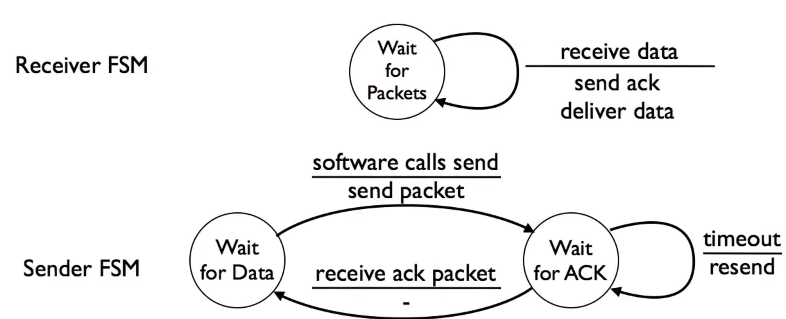
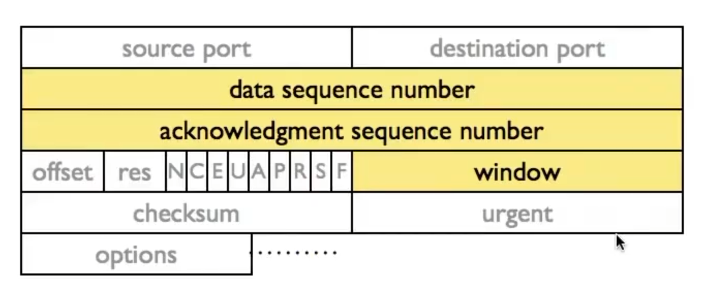

流量控制：解决发送方传输速度大于接收方接收速度的问题
stop-wait，sliding window是两种解决的算法，前者更好实现，后者效率更高 
stop-wait：发送方向接收方发送数据包之后，持续等待直到接收方完成接收，并发回一个ACK，发送方继续进行发送。如果等待ACK超过一个特定的时间，则认为数据包遗失(数据或者ACK丢失)，重新进行发送
接收者和发送者的FSM如下：

关键问题：重复检测，即可能链路比较慢，数据包并未遗失，但是由于超时而被误判，在重发数据包后，收到了ACK消息，此时不知道是第一次成功还是重发成功
解决方法：将每次数据包和ACK都附带一个相同的id，通过id判断ACK信息对应哪一次数据包发送，该id即序列号
缺点：效率低下
sliding window：扩展的stop-wait，可以同时发送n个数据包，n=1时退化为stop-wait
可以通过设置合适的n，使得发送和接收速率几乎相同
发送方维护以下三个变量：发送窗口的大小SWS，从接收方收到的最后一个确认LAR，发送的最后一个数据包LSS，满足 $LSS - LAR \leq SWS$，即正在发送的元素个数没有超出队列大小，当前正在发送$(LAR, LSS]$
接收方同样维护三个变量：接收窗口大小RWS，最后一个可接收数据包LAS,最后一个已接收数据包LSR，满足 $LAS - LSR \leq RWS$，即只接收包括LAS在内的往前SWS个数据包，并发回ACK，表示这个编号及其之前的数据包都确认了，这被称为累积确认
算法流程如下：发送方从编号最小的没有收到ACK的数据包开始，将从它开始SWS个数据包中未ACK的都进行发送；接收方接收从最小的没有接收到编号开始的RWS个中未接收的，更新累积确认，并进行ACK发回
累积确认消除了ack丢失的影响：当没有接收到一个ACK，但是接收到更大编号的ACK的时候，可以确认已经成功接收，只是ACK丢包
有 $RWS \leq SWS$，避免接收窗口大于发送窗口，导致多余的缓冲区完全不会用上，发生资源浪费。更大的发送窗口可以提高并行性(类比指令集流水线)，但是受到链路速率的瓶颈约束；更大的接收窗口能够缓存更多发送的数据包，但是同样受到网卡配置的约束
序列号需要的大小为SWS+RWS，如是stop-wait取序列号为2

