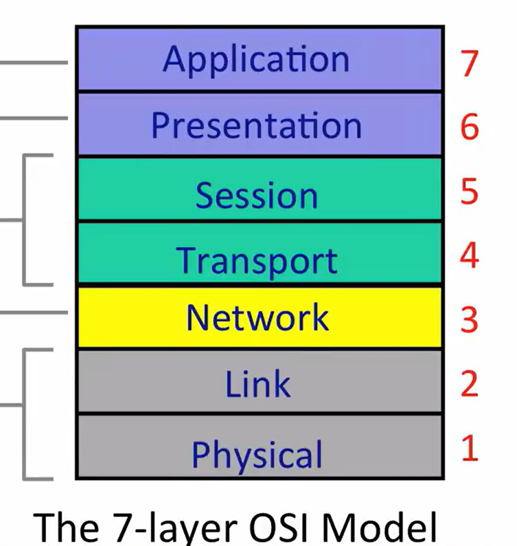

# Internet 四层模型

## 1. 为什么需要分层

两台主机上的应用要通信，数据可能经过网卡、局域网和许多路由器。把所有细节塞进应用会导致每个应用都要重新处理选路、不同链路、丢包和乱序等问题，因此 Internet 把通信拆成四层：

| 层 | 主要职责 | 典型协议或技术 | 处理的数据单位 |
| --- | --- | --- | --- |
| Application（应用层） | 规定数据对应用意味着什么 | HTTP、SMTP、SSH、FTP | message（消息） |
| Transport（传输层） | 在两个端点的应用之间提供传输服务 | TCP、UDP | segment / datagram |
| Network（网络层） | 根据最终目的地址，让数据报逐跳接近目的主机 | IP | IP datagram（IP 数据报） |
| Link（链路层） | 在一条链路上，把数据交给直接相邻的设备 | Ethernet、Wi-Fi | frame（帧） |

核心原则是：**上层只依赖下层提供的服务，不必知道下层如何实现。** 这类似于进程通过文件描述符调用 `read`/`write`：进程依赖系统调用的接口，不需要知道设备驱动如何控制硬件。但网络中的每层提供什么保证并不相同，不能把 TCP 的可靠性算到 IP 或链路层头上。

## 2. 链路层与网络层

链路层解决的是局部问题：

> 已经知道要交给哪个相邻设备后，如何跨过当前这一条链路把数据送过去？

例如，主机到家庭路由器可以使用 Wi-Fi，路由器之间可以使用光纤或 Ethernet。每一种链路都可以有不同的帧格式和发送方式。

网络层解决的是全程方向问题：

> 数据报的最终目的 IP 地址是什么？在当前节点应该选择哪个下一跳或出接口？

因此，与其说“网络层是链路层的抽象”，更准确的说法是：**网络层使用链路层提供的一跳交付服务，把许多次一跳交付组合成通往最终目的主机的路径。**

```text
源主机 A --一跳--> 路由器 R1 --一跳--> 路由器 R2 --一跳--> 目的主机 B
              链路层                 链路层                 链路层

网络层：根据 B 的最终 IP 地址，在每个节点不断决定下一跳
```

网络层决定的下一跳不一定是另一台路由器：如果目的主机就在当前链路上，下一跳可以直接是目的主机。

## 3. 路由器是两层的交界设备

路由器在每一跳重复下面的过程：

```text
链路层：从入接口收到上一跳发来的帧
    ↓
去掉当前链路的帧头，取出其中的 IP 数据报
    ↓
网络层：读取最终目的 IP，查询转发表，决定出接口和下一跳
    ↓
链路层：为下一条链路创建新帧，发送给下一跳
```

更具体地说，普通 IP 路由器会接收发给本机链路地址的帧，检查 IP 数据报，减少 TTL（最大剩余跳数），查询转发表，然后找到下一跳的链路地址，创建新的链路层帧并发送。

这里有一个重要不变量：

- IP 数据报中的**最终目的 IP 地址**通常跨越整条路径保持不变。
- 链路层帧只服务于**当前一跳**；经过路由器后，旧帧结束，出接口会创建新帧，因此链路层源地址和目的地址会随每一跳改变。

所以路由器不是把收到的整个帧原封不动地搬到另一个接口，而是“接收一跳的帧 → 按 IP 选路 → 为下一跳重新封装”。普通路由器通常也不需要理解 HTTP 内容或维护 TCP 字节流的可靠性状态。

## 4. IP：网络层的共同语言

要通过 Internet 发送数据，网络层共同使用 Internet Protocol（IP）。一个 IP 数据报包含最终目的 IP 地址和载荷；每台路由器可以根据目的地址把它送得更接近目的主机。

IP 提供的是 **best effort（尽力而为）** 服务：网络会尝试交付，但不承诺结果。数据报可能：

- 丢失；
- 损坏；
- 重复；
- 延迟很久；
- 与其他数据报乱序到达。

因此，“发送端已经把数据报交给 IP”并不能证明“目的端一定收到了它”。如果应用需要更强的保证，必须由端系统上的传输层或应用自己补足。

## 5. 传输层：TCP 与 UDP

传输层位于应用层和 IP 之间，负责端点应用之间的传输。它不负责选择每一跳的路径。

- **TCP（Transmission Control Protocol）**向应用提供可靠、有序的字节流。它利用序号、确认和重传等机制，在不可靠的 IP 之上恢复丢失和乱序的数据。
- **UDP（User Datagram Protocol）**保留消息边界，但不提供 TCP 式的可靠、有序保证。应用可能选择它，是因为应用能够容忍丢失、自己实现恢复策略，或者过期数据即使重传回来也已经没有价值。

所以四层模型并不意味着通信必然可靠。可靠性是应用选择的服务性质，而不是 IP 的默认保证。

## 6. 应用层与同层通信

应用层决定字节的具体含义。例如 HTTP 定义请求和响应的格式；网络层并不理解 `GET`、URL 或网页内容。

协议图经常把两台主机的同一层画成“互相通信”，但这表示的是**逻辑上的同层协议关系**。真实数据仍然要在发送端逐层向下，再在接收端逐层向上：

```text
发送端：Application ↓ Transport ↓ Network ↓ Link
                                               跨越若干链路和路由器
接收端：Application ↑ Transport ↑ Network ↑ Link
```

发送时，上层对象被放进下层对象的载荷中，这叫 **encapsulation（封装）**。例如：

```text
链路层帧 [ IP 数据报 [ TCP 段 [ HTTP 消息 ] ] ]
```

每层主要解释自己的首部，并把内部载荷交给相应的上层处理。

## 7. 为什么说 IP 是 Internet 的“细腰”


IP 上面可以运行 TCP、UDP 等不同传输协议和大量应用；IP 下面可以使用 Ethernet、Wi-Fi、DSL、移动网络等不同链路技术。只要双方都能承载 IP，就可以自由组合。

如果每种上层协议都要分别适配每种链路技术，组合数量会接近“上层协议数 × 链路技术数”；引入共同的 IP 层后，只需要让上层和下层分别适配 IP。代价是这个共同层必须足够简单，因此 IP 只提供较弱的 best-effort 服务。

## 8. Internet 四层模型与 OSI 七层模型



本课程使用 Internet 四层模型。OSI 七层模型把部分职责拆得更细，两者可以近似对应为：

| Internet 四层 | OSI 七层中的对应位置 |
| --- | --- |
| Application | Application + Presentation + Session（第 7～5 层） |
| Transport | Transport（第 4 层） |
| Network | Network（第 3 层） |
| Link | Data Link + Physical（第 2～1 层） |

工程中常说的 L2、L3、L4、L7 沿用了 OSI 的编号：L2 常指链路层，L3 常指 IP 网络层，L4 常指 TCP/UDP 传输层，L7 常指 HTTP 等应用层协议。这个对应是职责上的近似映射，不代表真实实现必须严格拆成七个独立模块。

## 9. 一句话总结

> 应用层定义数据的意义；传输层决定端点之间需要怎样的传输服务；网络层根据最终 IP 地址逐跳选择方向；链路层负责把数据实际送过当前这一跳。路由器在链路层接收上一跳，在网络层选择下一跳，再通过链路层发送出去。

## 讲义依据

- AIGC `R048`，§“链路层与网络层：相邻交付怎样组成全程路径”、§“四层职责总表与 IP thin waist”、§“Internet 四层与 OSI 七层”。
- 官方 `R028`，文本第 6～47 行：datagram、最终目的地址、best effort 与封装的定义；第 141～151 行：逐层封装和多路复用。
- 官方 `R041`，p.49：Internet router 的逐包处理流程；p.52 起：IPv4 转发表使用最长前缀匹配。

交叉核对未发现 AIGC 讲义与官方材料在上述概念上的冲突。
