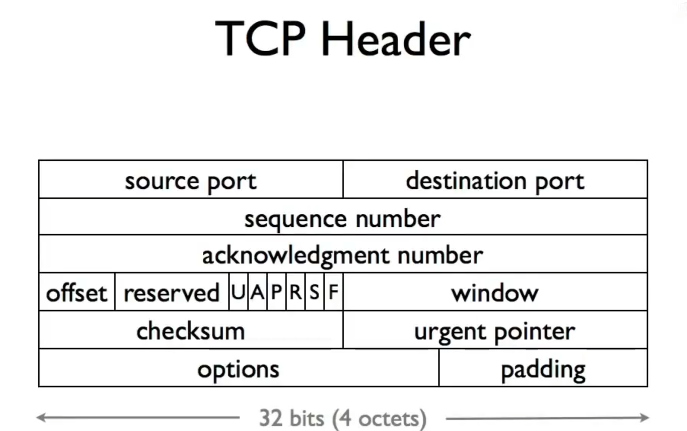

TPC header 的结构如下

(其中octet为计算机网络中专指8个bit，历史上byte并不保证为8个bit)

序列号是数据负载第一个字节的序列号，确认号是负载最后一个字节加一，即发回确认的第一个字节的序列号
eg：sequence number = 4000，负载大小为500字节，则acknowledge number = 4500
单向数据流发回的ACK是一个负载为空的TCP段，双向数据流会在相互通信的TCP段中包含ACK number
checksum表示校验和，window包含了发送方窗口大小的信息
UAPRSF都为布尔控制位，U：紧急位 A：ACK位 P:推送位 R：reset位，重置当前连接 S：SYN，用于建立连接 F：FIN，用于终止连接
urgent机制一般用于传达控制命令，当U=1时，会优先读取urgent pointer指向位置的内容，但是目前异步控制已经成熟，这是历史遗留内容
由于可能存在options，并且长度不固定，offset即为options的长度，可以通过它来定位负载的位置
