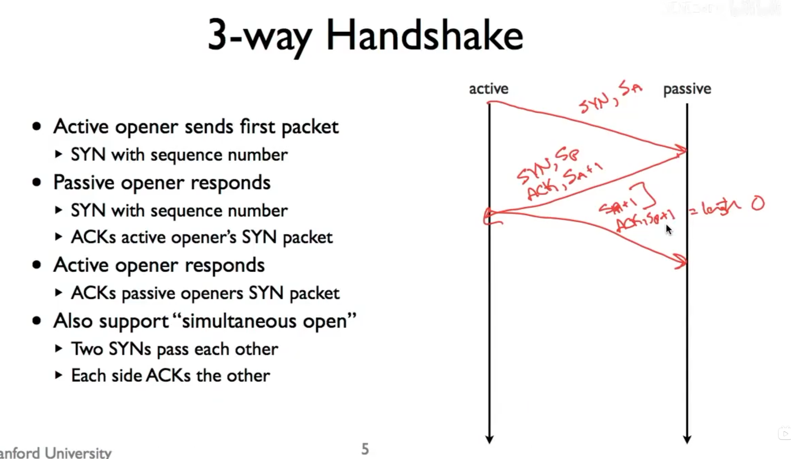
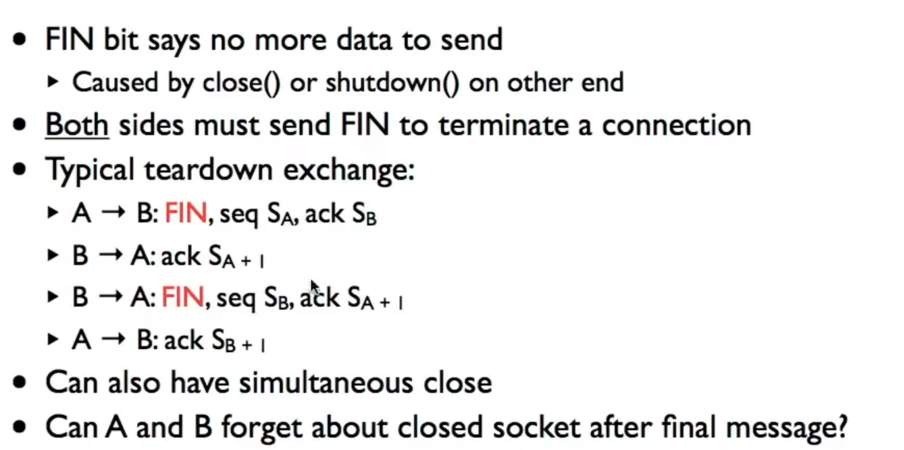
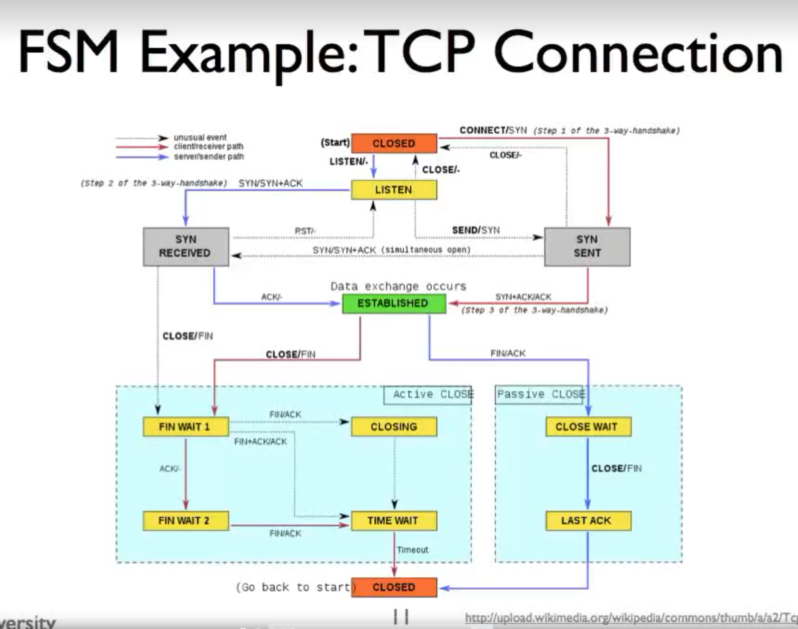

TCP 连接的建立

发送方发送数据包之后，接收方得到的数据呈现 (SYN) 负载 (FIN)的形式，其中SYN 和 FIN为布尔位，如果在TCP header中存在，就会追加到负载的前/后
三次握手中的序列号是字节流的字节编号，S_A和S_P一般取随机值，防止被攻击
Sequence number是当前数据包发送的数据的第一个字节的编号，Acknowledgment number是返回接收方接收到最后一个数据的字节编号+1
在三次握手中，负载一般大小都为0。
1.第一次SYN，主动发送方发送的包中，TCP header 的 SYN被设置，同时包含S_A表示初始序列号。
2.第二次SYN-ACK，被动发送方接收到以后，传回数据包，TCP header中 SYN和ACK都被设置，同时包含S_P表示被动发送者初始序列号，由于第一次SYN的包中，接收到了SYN占一个字节位，且该字节位是S_A，所以acknowledgment number设置为S_A+1
3.第三次ACK，当前字节流是从S_A+1开始，第二次SYN-ACK中SYN占了一个字节位，所以acknowledgment number为S_P+1
4.第三次ACK的时候没有设置SYN位，所以从主动发送端向被动发送端发送数据包时，sequence number=S_A+1(第一次SYN占用了S_A),acknowledgment number = S_P+1

同时打开：两端都是主动发送方，相互知道对方的端口号，都并行进行SYN，接收到对方的SYN之后进行SYN-ACK，一共四段通信，主要用于 NAT / P2P 穿透

TCP连接的关闭

连接关闭时，通过FIN表示发送方没有更多的数据要发送了，由于TCP连接是双向的，所以直到两方都没有数据要发送的时候，连接才会终止
关闭的过程如下，假设A与B的TCP通信中，A是最先关闭的一方
1.A向B发送一个FIN,seq=S_A,ack=S_B，负载为空的FIN包
2.B接收到该包，然后回复一个seq=S_B，ack=S_A+1，负载为空的ACK包
3.B再发送一个FIN包，seq=S_B，ACK=S_A+1，负载为空的FIN包
4.A接收到FIN之后，最后传回一个seq=S_A+1,ACK=S_B+1，负载为空的ACK包
事实上，AB之间也可以同时关闭，2和3步骤可能合并成一步，在B发送ACK之后可能再向A发送一些数据再发送FIN(半关闭)
当已经交换并确认消息之后，还不能立刻断开连接和删除状态，例如可能ACK丢失，重用端口对和此前端口完全重合
为了解决该问题主动关闭者A会进入time-wait状态，会在等待一段时间之后，才能够重用当前端口和状态，等待时间不能少于2*MSL(maximum segment lifetime)

