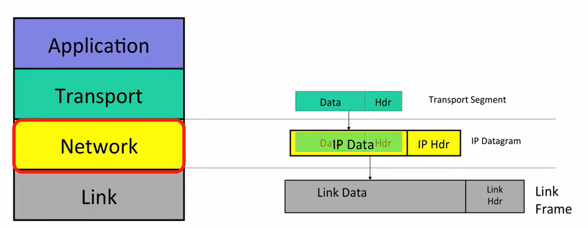
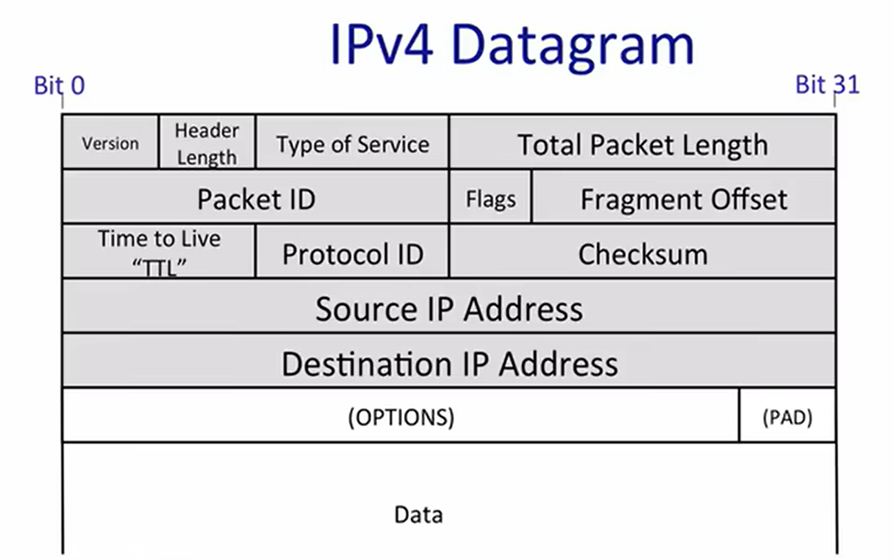

# The IP service model



## 1. IP 到底负责什么

IP（Internet Protocol）位于网络层。它的任务不是直接传送一整段网页、视频或文件，而是把上层交下来的数据装进一个个 **IP 数据报（IP datagram）**，再让路由器把数据报逐跳送向目标主机。

发送时，数据会逐层封装：

```text
应用数据
  ↓ 传输层添加 TCP/UDP 头部
Transport segment
  ↓ 网络层添加 IP 头部
IP datagram
  ↓ 链路层添加 Ethernet/Wi-Fi 头部
Link frame
```

对 IP 来说，整个 TCP/UDP segment 都只是 payload（载荷）。IP 通常不关心其中是网页请求、语音还是文件片段，只负责根据 IP 头部完成主机到主机的投递。这就是**封装**：外层协议只处理自己的头部，并把内层对象整体当作数据。

## 2. 什么叫“数据报是自包含的”

每个 IP 数据报都随身携带独立转发所需的信息，最重要的是：

- `IP DA`（Destination Address）：最终目的主机的 IP 地址；
- `IP SA`（Source Address）：源主机的 IP 地址；
- `Protocol`：载荷应该交给 TCP、UDP、ICMP 等哪一种上层协议；
- `TTL`：这个数据报最多还能经过多少跳。

因此，路由器拿到一个数据报后，只需要查看这个数据报自己的目的 IP，再查询本地转发表，就能决定下一跳，不需要先看到前一个数据报。

可以把它理解为一张写有最终收件地址的明信片。邮局每到一站都根据收件地址决定下一站；地址写的是**最终目的地**，不是仅仅写下一家邮局。

“自包含”只针对 IP 层的独立转发，并不表示一个包包含了完整应用消息。一个大文件仍然可能分散在许多数据报中，最终的排序、补缺和组合需要上层协议处理。

## 3. IP 服务模型的四个核心性质

### 3.1 Datagram：逐个处理数据报

IP 的基本处理单位是数据报。每个数据报单独查表、单独转发，两个连续发送的数据报不必走同一条路径，也不必按发送顺序到达。

```text
先发送 D1，再发送 D2
          不代表
接收端一定先收到 D1，再收到 D2
```

### 3.2 Unreliable：不提供可靠性保证

“不可靠”不是说数据报一定会丢，而是说 **IP 的服务契约不保证结果**。一个数据报可能：

- 正常到达；
- 丢失或很晚才到；
- 重复到达；
- 与其他数据报乱序到达；
- 内容被破坏，甚至被送往错误目标。

IP 不会因为普通数据报丢失就自动重传，也不会为每次发送返回可靠的成功确认。现实网络通常工作得很好，但这是实际运行效果，不是 IP 向上层承诺的保证。

### 3.3 Best effort：尽力而为

“尽力而为”表示路由器会按照转发表尝试把数据报送近最终目的地；队列满、链路故障、TTL 耗尽等情况下则可能丢弃它。

因此：

```text
best effort ≠ 保证送达
unreliable  ≠ 故意随便丢包
```

前者描述网络仍会努力转发，后者描述这种努力没有结果保证。

### 3.4 Connectionless：无连接

IP 在发送前不需要先进行握手，也不会在所有沿途路由器中建立一条专用通道。每个数据报依靠自己的头部独立前进，网络核心不必为每一对通信方维护强制的 per-flow state（按通信流保存的状态）。

无连接不表示两台主机不能持续通信，而是表示 **IP 本身没有 TCP 那样的连接建立、序号、确认和重传状态机**。如果应用需要可靠、有序的字节流，可以在 IP 之上使用 TCP。

这四个性质其实互相配合：数据报之所以能无连接地转发，正是因为它自带目的地址；数据报彼此独立，所以 IP 不保证整体顺序；网络只承诺 best effort，因此更强的可靠性必须由端系统上的 TCP 或应用构造。

## 4. 一个数据报经过路由器时发生什么

简化后的过程是：

1. 路由器收到发给自己的链路层帧，并取出里面的 IP 数据报；
2. 检查 IPv4 版本、长度和首部是否合法；
3. 将 `TTL` 减 1，并更新 IPv4 header checksum；
4. 如果 TTL 已耗尽，就丢弃数据报；否则根据目的 IP 查询转发表；
5. 找到下一跳后，把同一个 IP 数据报装进一个新的链路层帧，从相应端口发出。

因此，逐跳传输时链路层头部会更换，而源 IP 和最终目的 IP 通常保持不变。路由器只完成了一次局部转发，并不能由此证明数据报已经到达目标，更不能证明目标应用已经处理成功。

## 5. IPv4 为可用性提供的几个简单机制

### TTL：防止永远循环

路由表在变化期间可能暂时形成环路。`TTL`（Time To Live）每经过一台路由器减 1，减到 0 时数据报被丢弃，从而给数据报的最大跳数设置上限。它不能消除路由环路，但能防止一个包永久占用网络资源。

### 分片：适应链路大小限制

不同链路能承载的最大 IP 数据报大小不同，这个上限称为 `MTU`。当 IPv4 数据报大于下一条链路的 MTU 且允许分片时，路由器可以把它拆成多个更小的 IPv4 数据报。`Identification`、`Flags` 和 `Fragment Offset` 帮助目的主机识别并重组这些分片。

如果任何一个分片丢失，原始数据报就不能完整重组；IP 本身仍不会可靠重传。

### Header checksum：检测首部损坏

IPv4 的 checksum **只校验 IP 头部，不校验 payload**。它的作用是降低目的地址、长度、TTL 等关键字段损坏后被继续误用的概率，而不是保证应用数据完整。

由于路由器每跳都会修改 TTL，所以也要相应更新 header checksum。即使首部校验通过，也不能证明 TCP/UDP 数据一定没有损坏。

### Version 与 Options：识别格式并保留扩展入口

IPv4 使用 32 位地址，IPv6 使用 128 位地址。首部中的 `Version` 告诉接收者应按哪一种格式解析数据报。IPv4 也允许通过 `Options` 添加可选字段，但可变首部会增加路由器快速处理的复杂度，因此常用路径倾向于保持首部简单。

## 6. IPv4 数据报结构



IPv4 数据报由 **header + payload** 组成。最小 IPv4 header 为 20 bytes；`Total Length` 是整个数据报的长度，包括头部和载荷。

| 字段 | 通俗作用 |
|---|---|
| `Version` | 说明这是 IPv4 格式 |
| `IHL` | 说明 IPv4 头部有多长，从哪里开始才是 payload |
| `Total Length` | 整个数据报的总长度 |
| `Identification / Flags / Fragment Offset` | 描述 IPv4 分片以及如何重组 |
| `TTL` | 限制数据报最多还能经过多少跳 |
| `Protocol` | 指明 payload 应交给哪种上层协议 |
| `Header Checksum` | 检测 IPv4 头部是否损坏 |
| `Source Address` | 源主机 IPv4 地址 |
| `Destination Address` | 最终目的主机 IPv4 地址 |
| `Options` | 可选扩展字段，未必存在 |
| `Data` | 被封装的 TCP segment、UDP datagram、ICMP message 等 |

### Protocol ID 和端口号不要混淆

`Protocol` 字段是网络层向上层进行**解复用**的标识：接收主机根据它决定把 payload 交给哪个内核协议模块。

| Protocol ID | 上层协议 |
|---:|---|
| `1` | ICMP，例如 `ping` |
| `6` | TCP |
| `17` | UDP |

如果 `Protocol = 6`，内核就把 IP payload 交给 TCP。TCP 再查看目标端口号，把其中的数据交给对应应用：

```text
目的 IP 地址 → 选择目标主机
Protocol ID  → 在目标主机中选择 TCP / UDP / ICMP
目标端口号   → 在 TCP 或 UDP 中选择具体应用进程
```

所以 Protocol ID 不是端口号：前者区分协议模块，后者区分使用 TCP/UDP 的应用程序。

## 7. 为什么 IP 要设计得这么简单

全球不同类型的链路和路由器都需要共同理解 IP。如果网络核心强制实现可靠重传、顺序恢复和复杂会话状态，每一台路由器都要承担更高的实现、维护和升级成本。

IP 因此只提供一个最小而通用的“主机到主机数据报”接口，把最终可靠性放在端系统实现。这体现了端到端原则：只有真正的通信端点才能最终确认完整应用数据是否成功送达和处理。

简单的 IP 底座也给上层留下选择空间：文件传输可以用 TCP 等机制追求完整可靠；实时音视频则可能宁愿丢掉已经过期的一小段数据，也不愿等待迟到的重传。

## 8. 一句话总结

> IP 的核心价值不是保证“包一定送到”，而是让每个自带最终目的地址的数据报无需预先建立连接，就能被异构网络中的路由器逐跳、尽力地转发；可靠性、顺序和应用成功由端系统上的更高层协议负责。

## 课程材料依据

- AIGC `R049`：*1-3 The IP service model*，重点为 00:00:45–00:17:30，以及“Datagram / Unreliable / Best effort / Connectionless”“IPv4 首部”各节。
- 官方 `R028`：*Datagrams, encapsulation, and multiplexing*，第 1–2 个文本块；确认最终目的地址、封装、解复用与 best-effort 的边界。
- 官方 `R023`：*Lecture notes*，第 1 个文本块；确认 IP 是 host-to-host、UDP 是 port-to-port，以及两者均为 best-effort datagram 服务。
- 官方 `R041`：*Packet switching II*，第 49 页；确认路由器处理数据报时的 TTL、checksum、转发表查询和重新封装步骤。

上述 AIGC 与官方材料在本笔记涉及的核心定义上没有冲突。
