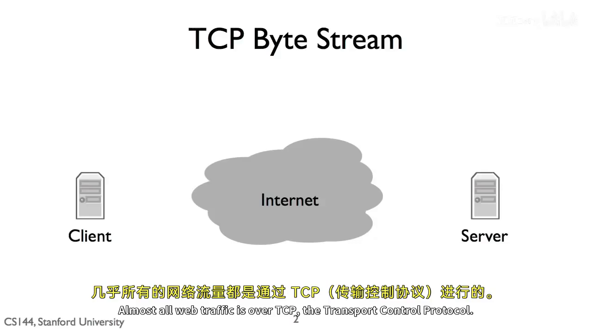
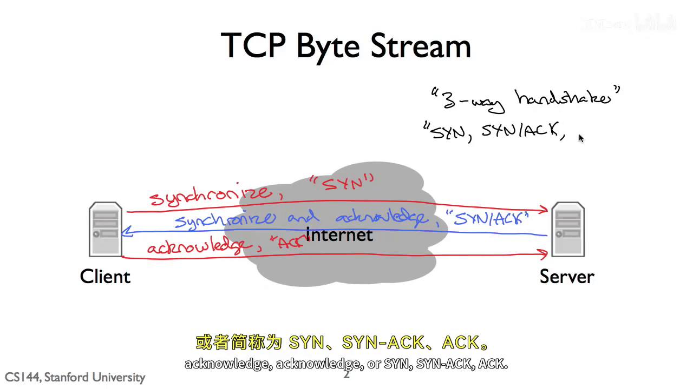
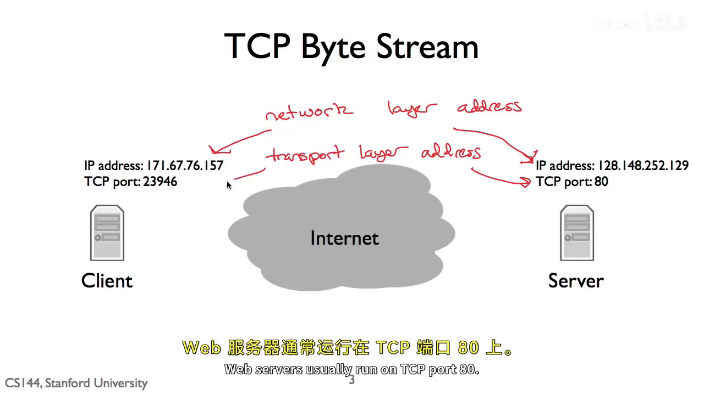
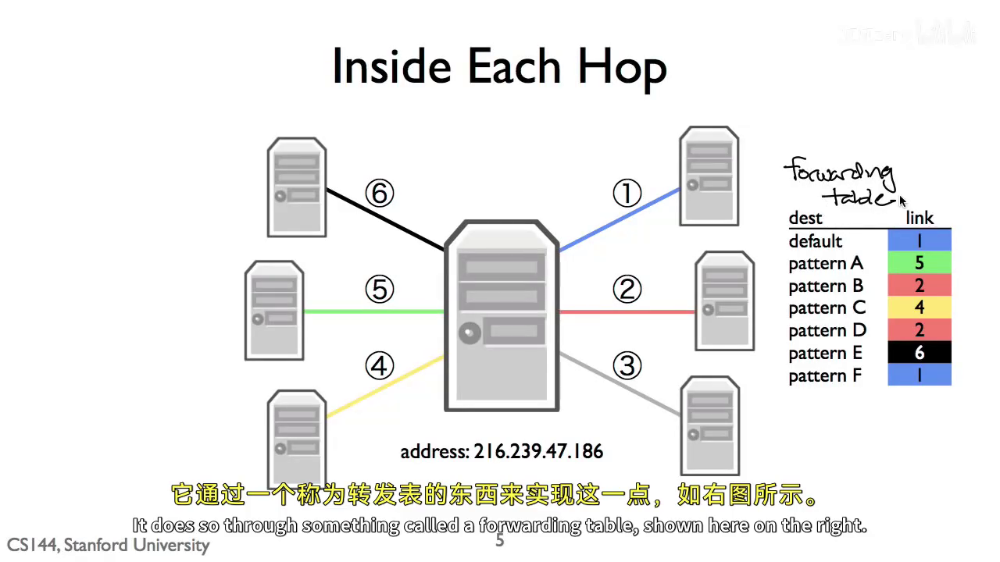
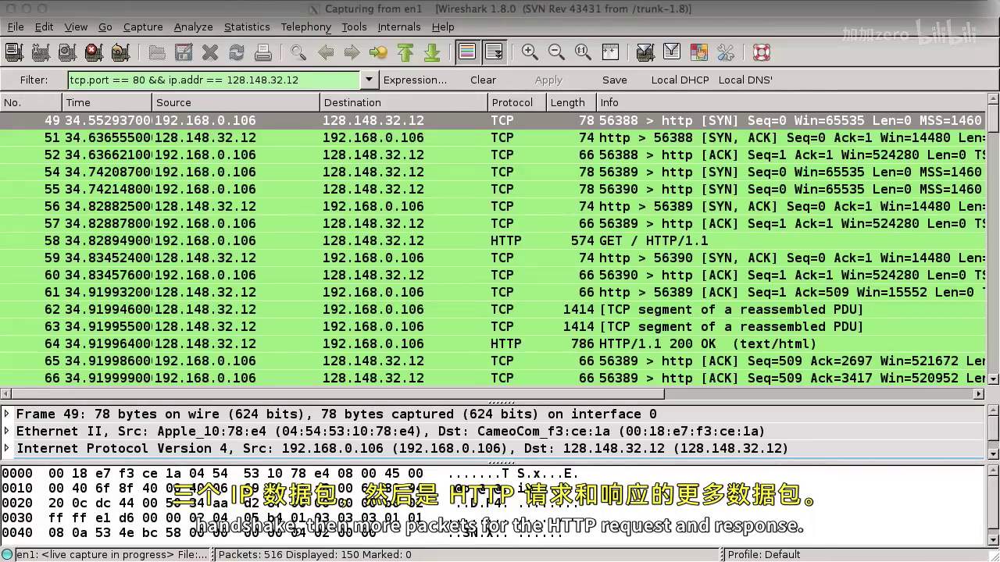
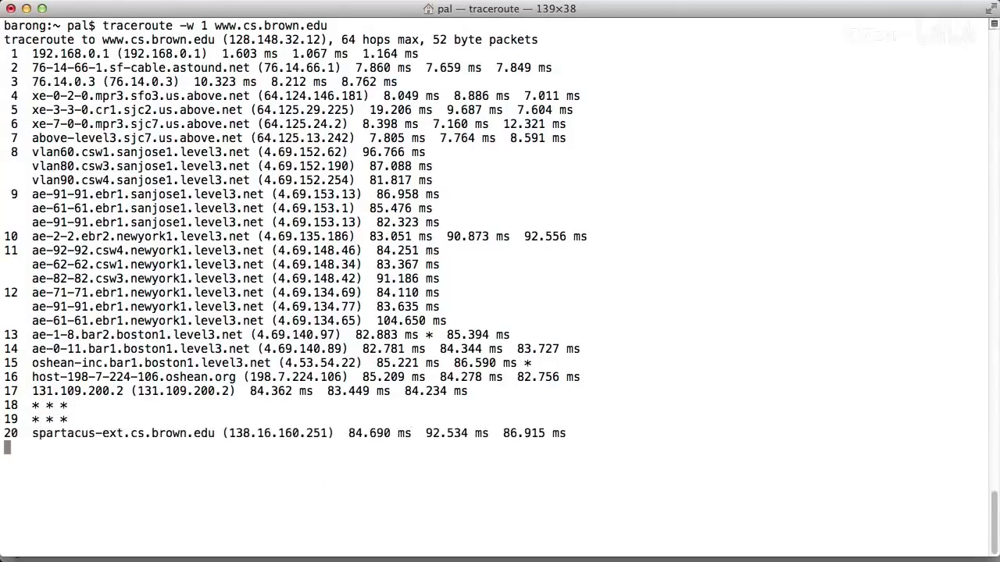

# 一个数据包的一生：从打开网页到跨网转发

本节把一次“浏览器打开网页”拆成一条可观察的因果链：浏览器先与服务器建立 TCP 连接，再发送 HTTP 请求；请求被逐层封装为可以在 Internet 中转发的数据；中间路由器只根据目的 IP 决定下一跳；最后可用 Wireshark 和 traceroute 分别观察端点交换与中间路径。

> 核心边界：端点关心 TCP 字节流和 HTTP；路由器关心一个个独立的 IP 数据报。两种描述是在看同一个事件的不同层。

## 1. 从网页请求到四层对象

假设浏览器要访问一台 Web 服务器。应用层首先产生的是 HTTP 请求文本，例如 `GET / HTTP/1.1`；TCP 把它作为**字节流**的一部分传输；IP 把 TCP 段作为负载放进数据报；链路层再把数据报放进当前这一跳的帧中。

```text
HTTP 请求  →  TCP segment  →  IP datagram  →  Wi-Fi/Ethernet frame
应用层          传输层           网络层            链路层
```



不要把这理解成四份独立数据。更准确地说，是同一份应用数据被逐层加上本层首部、成为下一层的负载。接收端按反方向验证、去掉这些包装，最后把字节交给浏览器。

## 2. TCP：先建连，再传 HTTP

服务器先在某个 TCP 端口上 `listen`，客户端主动请求连接。典型 TCP 三次握手是：

```text
客户端                              服务器
  SYN  ───────────────────────────►  表示“我请求建立连接”
       ◄──────────────────── SYN+ACK 表示“我同意，也确认收到了你的请求”
  ACK  ───────────────────────────►  表示“我确认收到了你的回应”
```



握手的成功只说明双方的 TCP 状态机已建立，可以开始双向可靠字节流传输；它不等于网页已经请求或加载成功。握手之后才会出现 HTTP 的 `GET`，服务器再在同一 TCP 连接上返回 HTTP 响应。

TCP 是**字节流**而不是保留 `send()` 边界的消息流：一个 HTTP 响应可以被拆成多个 TCP 段，接收端也可能一次 `recv()` 读到多段的拼接结果。HTTP 自己负责界定请求和响应的边界。

## 3. IP 找主机，端口找该主机上的应用

一台机器可能同时运行浏览器、SSH、Web 服务、DNS 等程序，所以只知道目标 IP 还不够。IP 地址让网络把数据报送到正确的**主机**；TCP 端口让该主机的协议栈把数据交给正确的 **socket/进程**。



课程图中的一个例子是：

```text
客户端：171.67.76.157:23946
服务器：128.148.252.129:80
```

其中 `:80` 是服务器监听的 HTTP 端口，`:23946` 是客户端为这次连接使用的临时源端口。连接在两端由四元组唯一标识：

```text
(源 IP, 源端口, 目的 IP, 目的端口)
= (171.67.76.157, 23946, 128.148.252.129, 80)
```

因此，同一个服务器 `IP:80` 能同时服务很多客户端：每条连接的客户端 IP 或源端口不同。反向报文的四元组则把源与目的交换。

当浏览器访问 `http://192.168.1.1` 这类路由器管理地址时，含义也是一样的：浏览器向“拥有该 IP 的路由器”上监听 `80`（或 HTTPS 的 `443`）端口的 Web 管理服务发起连接。不是“访问 IP 的应用层”——IP 只是网络层地址，真正被访问的是 `IP:port` 上的服务。

## 4. 从本机到服务器：逐跳而非一根直连导线

客户端和远端服务器通常不直连。一个 packet 先经第一跳到家庭 Wi-Fi 接入点/路由器，再在运营商和骨干网络的多个路由器之间转发，最后抵达服务器。

```text
电脑 ──(Wi-Fi 或网线)── 家用路由器 ──(常见为光纤)── ISP 路由器
     ── 多个骨干路由器/链路 ── 目标网络路由器 ── 服务器
```


`hop`（跳）就是路径中相邻两个节点之间的一次链路传输。第一跳可能是无线，之后大多数远距离链路通常是光纤；但“路由”本身指的是决定下一跳的逻辑，不等同于某一种物理介质。

## 5. 转发表：路由器的“下一步导航表”

每个路由器收到 IP 数据报后，查看其**目的 IP 地址**，从转发表中选出一个出口接口和下一跳。路由器不需要知道完整路径，也通常不关心 TCP 端口、三次握手或 HTTP 内容。



可以把转发表想成：

| 目的地址前缀 | 下一跳/出口 | 含义 |
|---|---|---|
| `192.168.1.0/24` | LAN | 局域网内，直接向 LAN 发送 |
| `10.1.2.0/24` | 接口 A | 特定内网段走接口 A |
| `0.0.0.0/0` | 上游路由器 | 其他目的地走默认路由 |

如果多条规则都匹配，选择**最长前缀匹配**：匹配范围越小、描述越具体的规则优先。例如 `10.1.2.7` 同时匹配 `10.0.0.0/8` 与 `10.1.2.0/24` 时，选 `/24`。

`0.0.0.0/0` 是默认路由，匹配任何 IPv4 地址，却是最不具体的规则。家庭路由器和边缘网络靠它把“不在本地网络”的流量交给上游 Internet。

路由器也可以是通信终点：若目的 IP 正好是路由器自己的管理地址，它不会继续转发，而是交给自己的本地协议栈和管理 Web 服务处理。

## 6. Wireshark：把抽象还原成真实报文

课程用 Wireshark 观察浏览器访问 Brown CS Web 服务器的过程。显示过滤器：

```text
tcp.port == 80 && ip.addr == 128.148.32.12
```

它只保留“涉及 TCP 80 端口，并且涉及该服务器 IP”的双向报文。抓包中的真实端点是：

```text
192.168.0.106:56389  <──TCP──>  128.148.32.12:80
```



列表可按时间读为：

```text
客户端:56389 → 服务器:80       SYN
服务器:80    → 客户端:56389    SYN, ACK
客户端:56389 → 服务器:80       ACK
客户端       → 服务器          GET / HTTP/1.1
服务器       → 客户端          HTTP/1.1 200 OK
```

Wireshark 下方的协议树把同一帧解释为 `Ethernet → IPv4 → TCP → HTTP`。这是“逐层封装”在真实字节上的证据：每一层不是额外复制了一份数据，而是解释同一缓冲区中不同的首部与负载区间。

抓包里的 `192.168.0.106` 是私有地址。在家庭网络访问公网时，路由器通常会做 NAT/NAPT，把出站报文的源 IP 和常常连同源端口改写为公网可用的映射；因此在本机网卡抓包看到的是 NAT 前的私网端点。

## 7. traceroute：观察包可能经过的中间路由器

Wireshark 回答“我的网卡上实际发出和收到什么”；`traceroute` 尝试回答“这些包经过了哪些 hop”。课程示例：

```bash
traceroute -w 1 www.cs.brown.edu
```



输出中的每一行通常是一个 hop，以及多次探测的往返时间（RTT）。第一跳常是家庭路由器，例如课程中的 `192.168.0.1`；后续会进入 ISP、骨干网和目标网络。

星号 `*` 的正确含义只是：该 hop 对本次探测的回复没有在等待时间内到达。它**不能**单独证明该处断网或后续没有路由器——设备可能仍然转发普通流量，只是不回应或限速回应 traceroute 探测。RTT 也是从本机发出探测到收到回复的往返样本，包含双向路径的传播、排队和处理时间，不能直接当成精确单程延迟。

## 8. 一次网页访问的最小因果链

```text
1. 浏览器确定远端端点（服务器 IP + TCP 端口）
2. TCP：SYN → SYN-ACK → ACK，建立字节流状态
3. HTTP：浏览器在字节流中发送 GET，服务器返回响应
4. 封装：HTTP ⊂ TCP ⊂ IP ⊂ 当前一跳链路帧
5. 转发：每台路由器按目的 IP 的最长前缀匹配选择下一跳
6. 到达：服务器 IP 层本地接收，TCP 按端口交给 Web 服务
7. 响应：服务器沿反向通信方向返回数据；路径不保证与去程完全相同
```

调试时也应按这个分层链检查：看不到 SYN 时先检查本机应用、路由与抓包接口；SYN 重传却没有 SYN-ACK 时，说明连接尚未建立；三次握手完成却没有 GET 时转向客户端应用；GET 已发但收到 HTTP 错误码时，TCP 已经成功，问题属于应用层。不要用 traceroute 的一行输出替代 TCP 或 HTTP 的端点证据。

## 来源与范围

- AIGC 讲义：`slides/aigc/1-4 A Day in the Life of a Packet/notes.tex`，对应视频 `CS144 p05`，截图时间覆盖 00:00:30--11:15。
- Winter 2024 官方材料：`others/course-info/assignments/R006-Checkpoint_5_down_the_stack_to_the_network_interface.pdf`（封装与网络接口）、`others/course-info/assignments/R007-Checkpoint_6_building_an_IP_router.pdf`（最长前缀匹配与路由器边界）、`slides/official/R028-Datagrams_encapsulation_and_multiplexing.txt`（IP best-effort 和 TTL/traceroute 背景）。

课程视频里的 Wireshark 版本、接口名 `en1`、明文 HTTP/80、Brown/MIT 地址和具体路径均是当时实验的样例；今天复现时它们可能变化。可迁移的是分析方法：区分层次、记录端点和过滤条件、按握手与请求响应的实际顺序解释证据。
