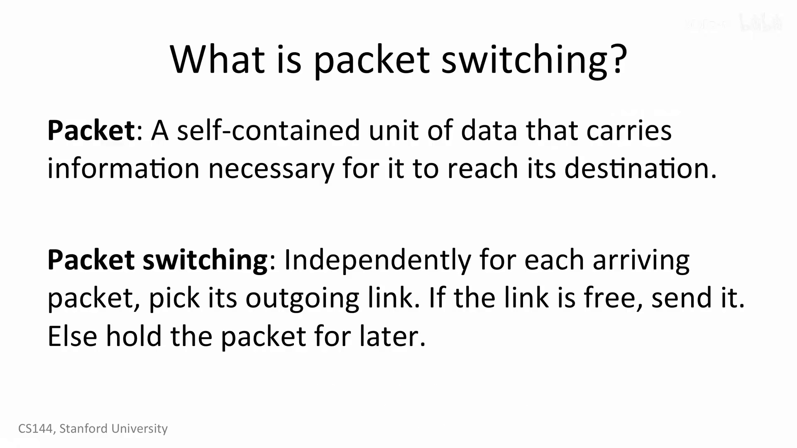
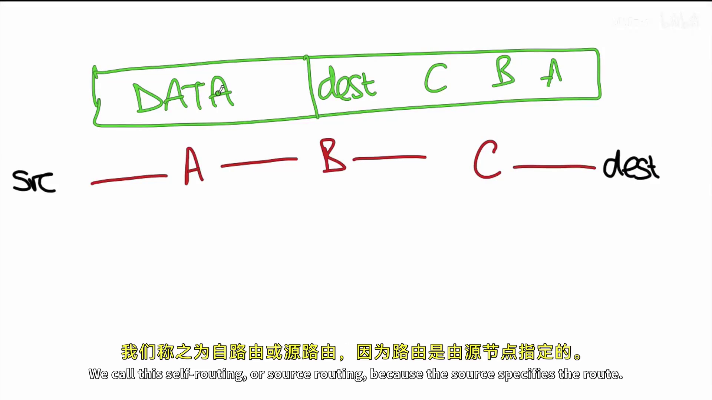
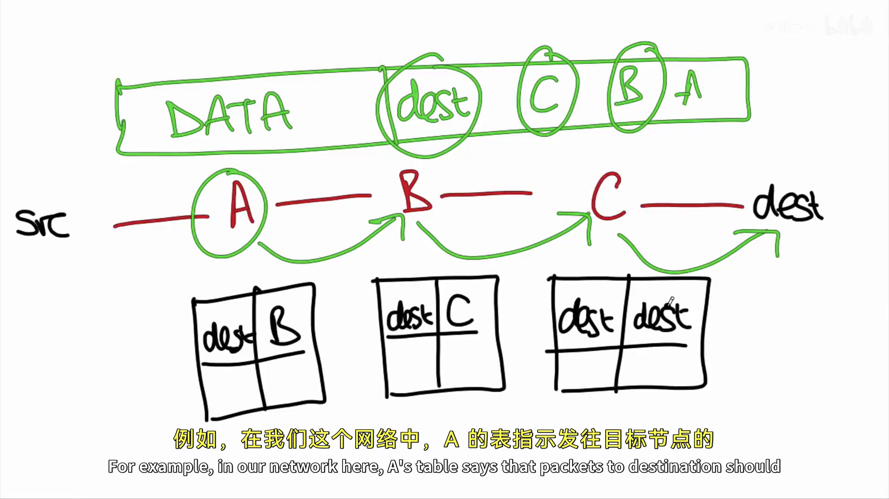
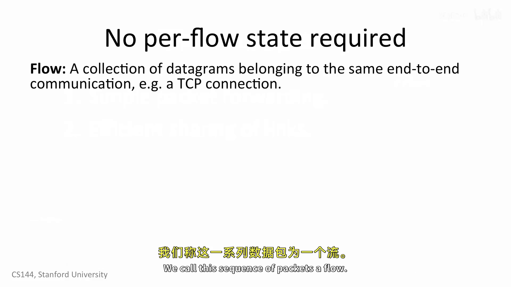

# Packet switching principle

> 核心模型：Internet 不为一次端到端通信预先占用一条专用线路。它把数据拆成许多**自包含的数据包**；每台中间设备收到一个包时，只决定它的**下一跳**，然后把包送出去或暂存到队列中。

## 1. 什么是分组交换

**分组（packet）**是可独立转发的一小块数据：除了 payload（载荷），它还带有网络将其送向目的地所需的信息。分组交换把连续的数据通信拆成离散的数据包，并对每个到达的包独立处理。

一个分组交换节点的最小动作是：

```text
收到包 → 决定出链路（outgoing link）→ 链路空闲则发送，否则入队等待
```

因此 B 可以刚把一个去 `C` 的包发出，紧接着就把下一个应去 `D` 的包发往另一条链路；同一条出链路忙时，后来的包必须排队。这里的“独立”指**转发决策以当前包为单位**，不等于每个包一定走不同路径。



## 2. 路径如何确定：两种模型

### 2.1 源路由：源主机写出完整路径

在**源路由（source routing，也称 self-routing）**中，源主机发送前把完整节点序列写进包头，例如：

```text
src → A → B → C → dest
包头：最终目的地 dest，以及 A、B、C 的显式路径
```

于是 A 不必根据网络拓扑推断路线；它只读取包头中给定的下一节点 B，B 再送往 C。也就是说，**一次传输的完整路径在源端确定**。



这种表示直观，但 Internet 中通常禁用或严格限制源路由：发送方能强行指定中间节点，会造成明显的安全和策略问题。

### 2.2 Internet 常用模型：目的地址 + 逐跳转发

现代 Internet 通常不把完整路径放在普通 IP 包中。包主要携带**最终目的 IP 地址**；每台路由器维护自己的转发表（forwarding table / FIB），其中的抽象规则是：

```text
目的地址前缀 → 下一跳或出接口
```

例如：

```text
src → A → B → C → dest

A 的表：dest → B
B 的表：dest → C
C 的表：dest → dest 所在的链路
```



所以要区分两件事：

- **控制面**预先维护转发表：路由协议、策略和链路状态的变化会更新 FIB。
- **数据面**在包到达时做本地查表：路由器不为这个包临时计算一条全网最短路径，只根据当前 FIB 选下一跳。

因此“逐跳决定”并不与“路由状态已提前计算”矛盾。某条链路故障或路由策略变化后，FIB 收敛完成，后续包可能改走其他路径；存在等价多路径（ECMP）时，不同流也可能被分到不同下一跳。

## 3. 图里的 switch 到底是不是路由器

本讲中 `packet switch` 是“能接收分组、查表并选出链路”的**通用抽象名词**。当表的键是目的 IP 地址、表项给出下一跳时，A、B、C 描述的就是 Internet 中的**路由器，或路由器所执行的三层转发功能**。

它不要与普通二层以太网交换机混为一谈：

| 设备/功能 | 查看什么 | 表项形状 | 解决的问题 |
|---|---|---|---|
| 二层交换机 | 目的 MAC 地址 | `MAC → 物理端口` | 同一 LAN 内帧从哪个端口出去 |
| 路由器（本讲的 packet switch） | 目的 IP 地址 | `IP 前缀 → 下一跳/出接口` | 到另一个 IP 网络时，下一跳是谁 |

路由器每经过一跳，通常会去掉旧的链路层帧头，并为下一跳重新封装新的 Ethernet/Wi-Fi 帧。因此，**IP 的最终目的地址通常不变，链路层的目的 MAC 地址则每跳改变**。所谓“三层交换机”也做目的 IP 查表，本质上是在硬件中实现路由功能。

## 4. 每个包独立转发带来的第一个结果：设备简单

一个 Web 请求、语音通话或固件下载都会包含多个数据包。属于同一端到端通信的这一组数据报称为一个**流（flow）**。

```text
一次 TCP 连接 / 一次语音通话
        ↓
多个 IP 数据报的集合 = 一个 flow
```



普通 IP 转发中，核心路由器无需保存“这是哪条 TCP 连接”“这个流以前发过什么”“何时需要删除它”等 **per-flow state（每流状态）**。它只需高效地执行：

```text
目的 IP → 查 FIB → 选下一跳 → 排队/发送
```

这带来三个实际好处：

- 不需要为每次网页访问沿途建立、拆除状态；
- 不会因为大量已经消失的连接留下状态而耗尽昂贵的高速内存；
- 发送端突然断电时，路由器无需发现并回收该流的状态——它只是不再收到这个端点的包。

这里的“不保存状态”必须精确理解：路由器仍保存**路由/转发表、邻居信息和队列**；省去的是与某个具体端到端流绑定的状态，而不是所有状态。

## 5. 第二个结果：统计复用让链路利用率更高

人们的网络使用通常是**突发的（bursty）**：加载一页网页后阅读一段时间，下载几段内容后又停下来。不同用户的突发大多不完全重合。

假设一条容量为 `R` 的链路被 Alice 和 Bob 共用：

```text
Alice 在读网页、Bob 在下载：Bob 的包可临时接近用满 R
两人同时下载：两人的包交错排队发送，共享 R
```

```text
时间 → | Alice 的包 | Bob 的包 | Bob 的包 | Alice 的包 |
```

链路物理上不会在同一时刻发送两份数据；“共享”是把不同流的包在时间上交错传送。这种按实际活跃程度、而非永久固定份额来分配容量的方式叫**统计复用（statistical multiplexing）**。

它与预留式电路交换的差别是：

| | 电路/固定预留 | 分组交换 |
|---|---|---|
| 空闲用户的份额 | 仍可能闲置 | 可被有包的用户使用 |
| 同时突发时 | 预留外的流量不能使用 | 包在队列中竞争链路 |
| 主要代价 | 利用率可能低 | 排队延迟、抖动，队列满时丢包 |

“高效共享”不保证每个流始终得到一半带宽，也不保证固定时延；公平性取决于调度算法和其他流量。当总到达速率长期超过链路速率时，队列会增长，最终产生丢包。这正是之后拥塞控制需要解决的问题。

## 6. 与 IP 分层的对应关系

把分组交换放回 Internet 的四层模型中：

```text
IP 数据报：携带最终目的 IP，路由器据此逐跳选择方向
链路层帧：只负责当前一跳，把数据报交给选定的下一跳
```

因此路由器的职责是“送近最终目的地”，不是保证已经到达，更不关心 TCP 是否可靠、HTTP 是否成功。IP 的逐包 best-effort 转发与 TCP 的可靠、有序字节流是不同层的职责。

## 7. 一句话总结

> 分组交换把通信拆成自包含的数据包：普通 Internet 包携带最终目的 IP，每台路由器依据本地 FIB 逐跳选择下一跳，而不维护每条通信流的状态；这既让转发设备简单，也让突发的多条通信能通过统计复用高效共享链路，但代价是出现排队、时延变化和丢包的可能。

## 课程材料依据

- AIGC `R051`：*1-5 Packet switching principle*。00:00:26–01:25 定义分组和逐包出链路选择；01:40–02:55 对比源路由与目的地址查表；03:01–05:51 解释 per-flow state 缺失；06:00–07:45 解释突发流量和统计复用。
- 官方 `R020`：*Notes*，Week 9。其家庭网络示例明确区分二层交换机的 `Ethernet → port` 映射（不查看 IP 头）和路由器的 IP 前缀路由表。

两份材料在本笔记的核心结论上没有冲突。这里将讲义中的通用术语 `packet switch` 映射到实际 Internet 的路由器功能，是为了避免与二层 Ethernet switch 混淆。
