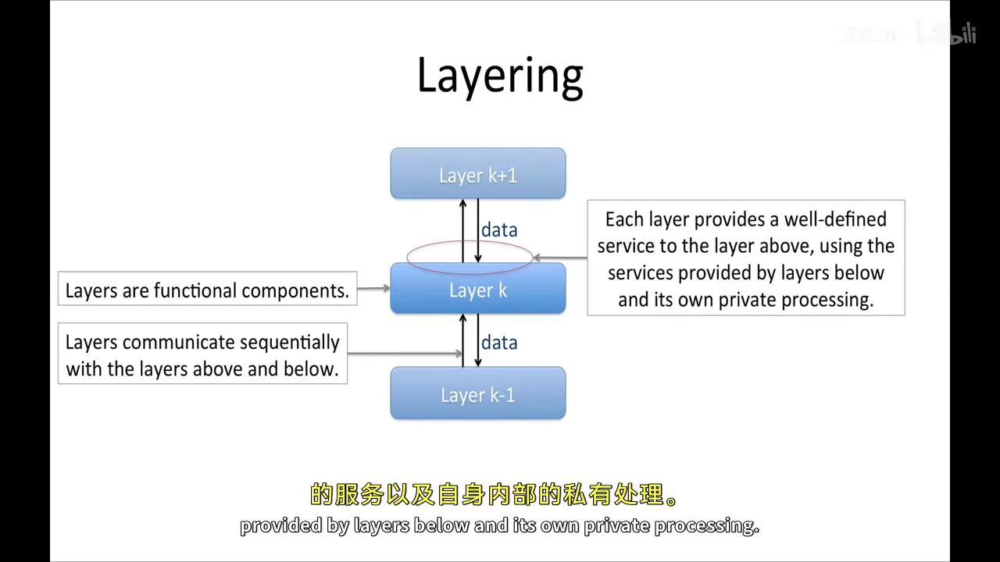
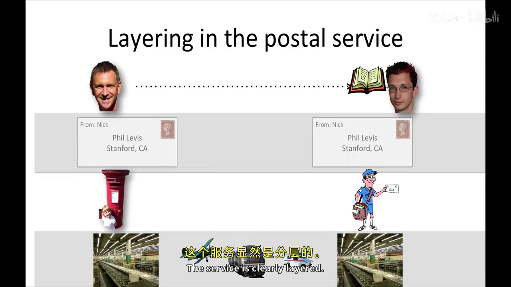
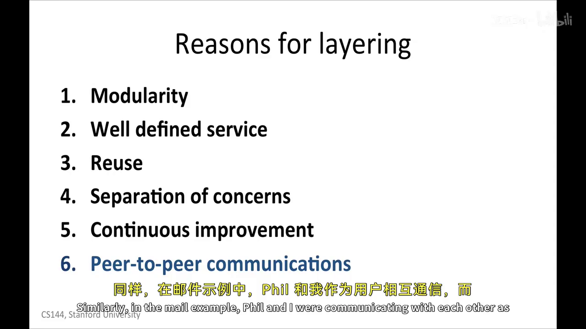
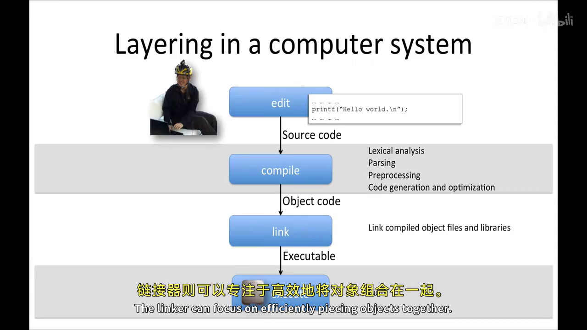
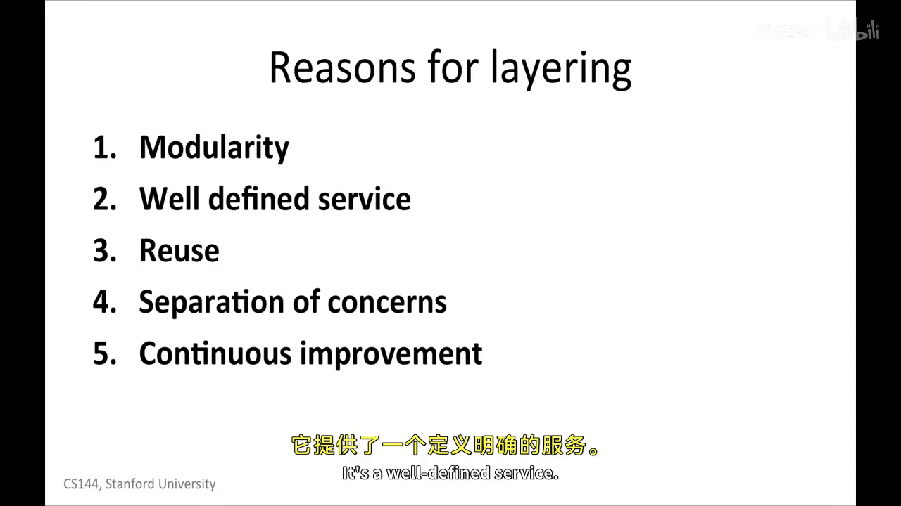
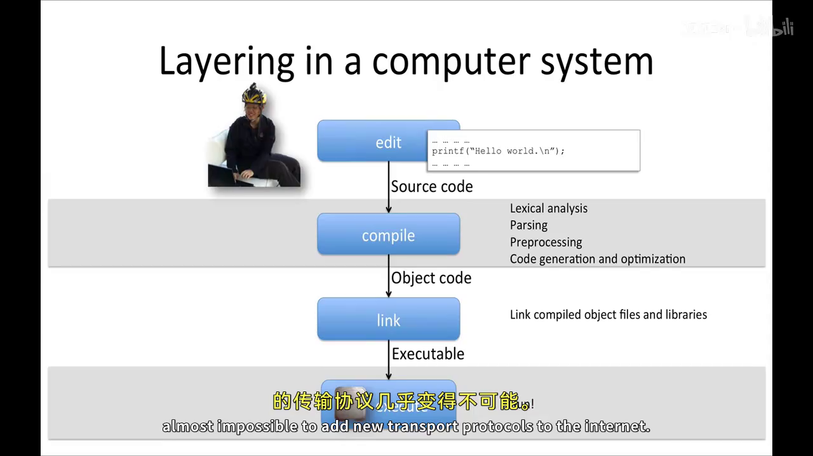

# 分层原则：接口、独立演进与越层代价

> 核心模型：一层不是简单画在另一层上方的方框，而是一个带有**服务契约**的功能组件。它使用下层提供的服务，结合自己的私有实现，再向上层提供新的服务。上层只依赖契约，不依赖本层内部步骤。

## 1. 什么叫“分层”

一个真正分层的系统需要同时区分三个概念：

| 概念 | 回答的问题 | 例子 |
| --- | --- | --- |
| 服务（service） | 这一层承诺提供什么能力 | IP 尽力把数据报送向目的主机 |
| 接口（interface） | 上层怎样请求这项能力 | 向网络层提交带目的地址的数据报 |
| 实现（implementation） | 本层内部怎样兑现承诺 | 查询转发表、选择下一跳、排队发送 |

因此，第 $k$ 层可以抽象成：

```text
下层服务 + 本层私有状态与处理  →  提供给上层的服务
```

上层可以观察接口的输入、输出和错误，却不应读取本层的私有状态，也不应假设内部一定经过哪些步骤。这样，依赖关系才被限制在相邻层之间。



分层最重要的不变量是：

> 如果第 $k$ 层的实现被替换，但它对上层承诺的可观察语义没有变化，那么第 $k+1$ 层不应被迫修改。

这比“把代码放进不同目录”更强。文件可以分开，隐式依赖仍可能遍布系统；只有接口稳定、实现细节被隐藏，模块才真正能够独立演进。

## 2. 邮政系统：路径复杂，但接口简单

假设 Nick 想把一本书寄给 Phil。他把书装进写有收件人与寄件人地址的信封，再把信封投入邮箱。之后可能经过分拣中心、卡车、火车或飞机，最后由投递员送到 Phil 手中。

```text
Nick → 信封/地址 → 邮箱 → 分拣与运输 → 投递 → Phil
```

对 Nick 来说，“按规定填写地址并交付信件”就是接口；邮政系统选择的运输路线是内部实现。运输方式从卡车换成高铁时，Nick 不必改变写信方式；只要地址语义和交付承诺保持不变，上层用户就不受影响。




分层没有消灭复杂性，而是把复杂性留在清晰的边界之后。用户只需理解当前层的契约，不需要一次掌握整个系统。

不过，类比不能替代真实协议语义。邮政可能提供挂号、追踪等保证，而 IP 只提供 best effort（尽力而为）的数据报服务；某一层到底保证可靠、按序还是仅仅尝试交付，必须由该层自己的服务模型说明。

## 3. Internet 中的分层与“对等通信”

Internet 的应用层、传输层、网络层和链路层各自有自己的职责。发送端某一层看起来是在和接收端的同一层通信，但数据并没有跨越网络直接跳到远端同层，而是逐层向下交付，在底层真正传输后，再由接收端逐层向上处理。

```text
发送端：Application → Transport → Network → Link
                                      ↓ 真实传输
接收端：Application ← Transport ← Network ← Link
```

例如，两个 TCP 模块在逻辑上交换 TCP segment；实际上，segment 会成为 IP 数据报的 payload，IP 数据报又会成为当前链路帧的 payload。所谓 peer（对等方）是**逻辑关系**，实际交付仍依赖下层。



这也解释了为什么路由器通常不需要理解 HTTP 或 TCP 字节流：它只需按照网络层契约处理 IP 数据报，再使用链路层把数据报送到下一跳。路由器知道得越少，应用和传输协议就越容易独立变化。

## 4. 编译工具链也是分层系统

分层并不只存在于网络中。程序从源码到执行，同样经过一条服务管线：

```text
source code → compiler → object file → linker → executable → processor
```

编译器负责把源语言翻译成目标文件，链接器负责组合目标文件与库，处理器负责执行指令。每个阶段接收一种表示，并向下一阶段输出约定好的表示。



替换编译器通常不要求重写链接器，但有一个严格前提：新编译器必须继续遵守相同的对象文件格式、符号规则、数据布局和 ABI（应用二进制接口）。如果调用约定或重定位格式改变，即使“仍然生成机器代码”，层间契约也已经被破坏。

因此，独立升级不等于没有平台假设，而是把平台假设集中在明确边界上。对于 C/C++，未定义行为、整数宽度、对齐和外部 ABI 都可能穿透抽象，不能把“有编译器这一层”误解成任意程序都天然可移植。

## 5. 为什么分层有用

课程将分层的主要收益概括为五点：

1. **模块化**：把复杂系统拆成边界明确的组件；
2. **定义清晰的服务**：每层明确说明自己保证什么、不保证什么；
3. **复用**：多个上层可以共同使用同一个下层能力；
4. **关注点分离**：实现者只需集中处理本层职责；
5. **持续改进**：接口不变时，可以局部替换或优化实现。



这些收益来自同一条因果链：

```text
窄接口 → 能够局部推理 → 能够复用 → 实现彼此隔离 → 能够独立演进
```

对通信系统还可以再加一项：每一层都能维护自己与远端对等层之间的协议视图，而无需理解下面每一跳如何搬运数据。

## 6. 打破分层：可能有收益，也会产生耦合

分层不是绝对禁令。有些工作确实必须接触更低层，例如操作系统使用架构专用汇编完成上下文切换或内存屏障；某些网络设备也会检查并改写更高层字段，以实现 NAT、负载均衡或安全策略。

问题在于：一旦上层依赖下层内部细节，替换成本就会沿着依赖传播。内核中的 x86-64 汇编不能直接在 AArch64 上使用；假设所有传输协议都有 TCP/UDP 端口的中间设备，也可能阻碍新协议部署。



因此，越层设计应被当作有证据的例外：明确它换来了什么性能或功能，记录依赖的底层事实，把平台专用代码集中到窄适配层，并为每个支持的平台单独验证。真正需要比较的是当前收益与长期耦合成本，而不是机械地坚持或反对分层。

## 7. 如何检查一个设计是否真的分层

可以逐层问五个问题：

- 这一层向上承诺的服务语义是什么？
- 合法输入、输出、失败和性能边界是什么？
- 上层是否读取了本层没有承诺公开的状态？
- 替换本层实现时，哪些组件必须跟着修改？
- 不可避免的越层依赖是否被集中、记录并测试？

如果一次局部替换迫使整个系统同步修改，那么图上即使画了很多层，也很可能只是名义上的分层。

## 总结

分层的核心不是层数，而是**稳定的服务契约与受控的依赖方向**。每层使用下层服务、隐藏自己的实现，再向上层提供新的抽象；因此系统能够被局部理解、复用和升级。越层有时不可避免，但它会把实现细节变成外部依赖，必须缩小并显式管理。判断分层是否成功，最直接的方法就是做一次替换实验：接口不变时，上层是否仍能正常工作。

## 课程材料依据

- AIGC `R052`：*1-6 Layering principle*。重点参考“核心模型：层是带契约的功能组件”“计算机系统实例：从源码到执行”“打破分层”和“五个通用理由”等部分。
- 官方 `R028`：*Datagrams, encapsulation, and multiplexing*，确认 datagram 与 ByteStream 都是服务抽象，并以邮政包裹说明外层只依赖可见规格、无需理解载荷内容。

两份材料在服务接口、实现隐藏和分层职责边界上没有冲突；AIGC 讲义进一步补充了编译工具链、ABI 与越层依赖的工程含义。
