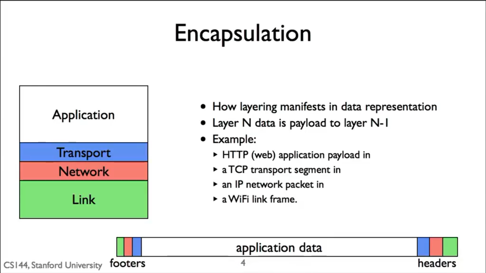
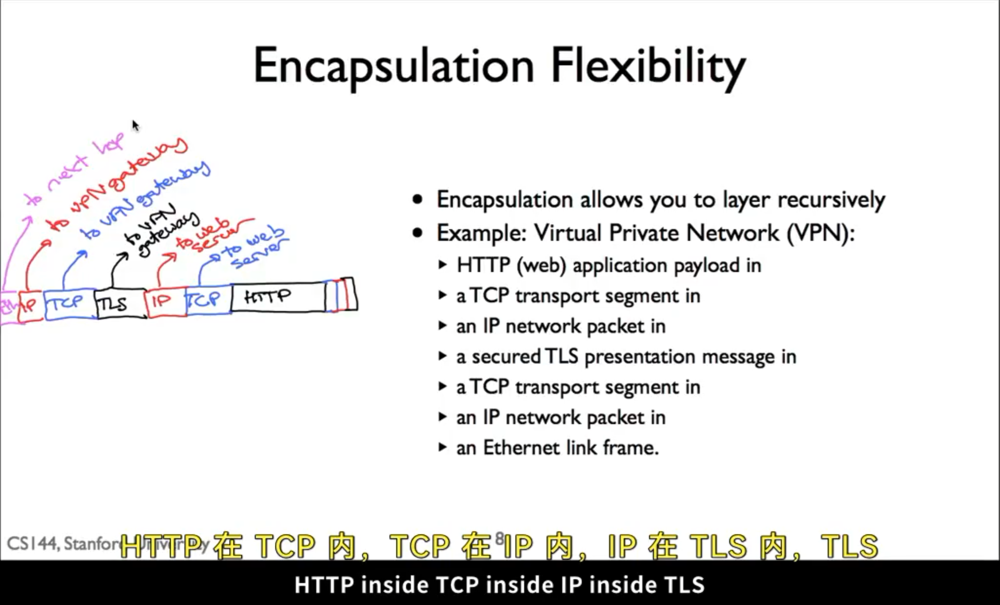

# 封装原则：把一个包裹装进另一个包裹

> 核心直觉：每一层都可以把上层交下来的内容当成一段普通数据，再补上“这一层办事所需要的信息”。因此，一个完整的网络包常常是很多层包裹套在一起。

## 1. 什么是封装

网络中的一层通常不需要读懂上层数据的具体含义。

- HTTP 层只是在表达“我要这个网页”；
- TCP 把 HTTP 内容当作负载（payload），补上端口、顺序和可靠传输所需的信息；
- IP 再把整个 TCP 段当作负载，补上源、目的 IP 地址；
- Ethernet 把整个 IP 包当作负载，补上当前这一跳在局域网中传输所需的信息。

可以把它想成寄快递：信放入信封，信封再放入快递箱，快递箱外再贴上本次运输的地址标签。外层只关心怎样把箱子送到下一处，并不需要阅读信的内容。

```text
Ethernet 帧
└── IP 包
    └── TCP 段
        └── HTTP 请求
```

发送端是逐层向下封装；接收端则逐层向上拆开。比如网卡先收到 Ethernet 帧，交给 IP；IP 发现这是交给本机的包后交给 TCP；TCP 最终把连续的数据交给浏览器中的 HTTP。



封装的好处是关注点清晰：TCP 不必理解网页长什么样，IP 不必理解 TCP 如何重传，Ethernet 也不必理解目标网站是什么。只要知道自己该在外面加什么信息、收到后该交给谁即可。

## 2. “递归封装”是什么意思

上面的四层已经是一次封装，但“上一层的 payload”本身还可以是一个已经完整封装过的网络包。也就是：**可以把一个 IP 包再装进另一个安全连接中发送。**

VPN（Virtual Private Network，虚拟专用网络）就是这个想法的典型例子。设想你在家访问公司的内部网站：公司内网地址不能从公网直接到达，但公司有一台能同时连接公网和内网的 VPN 网关。

浏览器本来会生成：

```text
HTTP GET → 内层 TCP → 内层 IP（目的地：公司内部网站）
```

这份“内层 IP 包”暂时不能直接从公网送到内部网站，于是 VPN 客户端把它当成新的负载，放进一条通向 VPN 网关的安全隧道：

```text
HTTP
  → 内层 TCP
    → 内层 IP（真正想访问的内部服务器）
      → TLS 加密隧道
        → 外层 TCP
          → 外层 IP（目的地：VPN 网关）
            → Ethernet（发送给当前下一跳）
```

因此可以简单记成：

```text
HTTP inside TCP inside IP inside TLS inside TCP inside IP inside Ethernet
```

这里有两层地址，它们回答的是不同问题：

- **外层 IP 的目的地址**：这份加密包此刻怎样到达 VPN 网关？
- **内层 IP 的目的地址**：VPN 网关解密后，应把原始包转发给哪台真正的服务器？

## 3. VPN 网关具体做什么

VPN 网关可以理解成加密隧道的出口，而不只是“代替浏览器访问网页”的机器。

1. 客户端把原始的内层 IP 包加密、封装，发送给 VPN 网关；
2. 网关收到外层 TCP/IP 数据后，验证并解开 TLS；
3. 网关取出内层 IP 包，按其内层目的地址转发到公司内网服务器；
4. 服务器返回的 IP 包到达网关后，网关再加密、封装，通过同一条 VPN 隧道发回客户端；
5. 客户端拆掉外层，得到原始返回包，交给本机 TCP 和浏览器。

```text
客户端  ⇄  加密隧道  ⇄  VPN 网关  ⇄  公司内网服务器
```

去程和回程的机制大体是镜像的：两边都把需要送出的内层 IP 包放入隧道、加密后发给对方。实际使用中客户端往往位于 NAT 后面，因此通常由客户端先建立并保持这条隧道，网关再沿已有连接把回包送回来。



## 4. VPN 为什么能保护隐私

VPN 主要保护的是 **客户端到 VPN 网关之间** 这段不可信公网路径。

- **加密**：旁路上的人看到的是密文，通常读不出其中的内层 IP 包和应用数据；
- **身份认证**：客户端确认连接的是可信 VPN 网关，网关也确认客户端有访问权限；
- **完整性保护**：被篡改的密文不会被正常接受，旧数据也不能随意拿来重复发送。

所以，公共 Wi-Fi、运营商和中途路由器可以看到你正在和 VPN 网关通信，却不应能直接读出隧道里的公司内网请求。

不过，VPN 并不是“让所有人都看不见”的魔法：数据到了 VPN 网关会被解密；若之后访问的是 HTTPS 网站，HTTPS 还会继续保护浏览器到网站这一段内容。VPN 像穿过公网的一条加密管道，HTTPS 则像写给具体网站的加密信封，两者可以同时存在。

## 总结

封装就是“上层数据 + 本层头部（有时还有尾部）”，而递归封装允许把一个已经完整的网络包继续当作新一层的负载。VPN 正是这样把原始 IP 包放入加密隧道，使客户端看起来像已经接入了远处的私有网络；VPN 网关负责在隧道和真实内网之间双向转发。

## 课程材料依据

- AIGC `1-7 Encapslation principle`，5:17–8:10：递归封装、VPN 网关、以及 `HTTP → TCP → IP → TLS → TCP → IP → Ethernet` 的完整示例。
- 官方 `R023`，29–31 行：以 IP over UDP 为例说明 VPN 能把一个 IP 包作为外层传输的载荷。两份材料的承载协议示例不同，但封装的核心思路一致。
