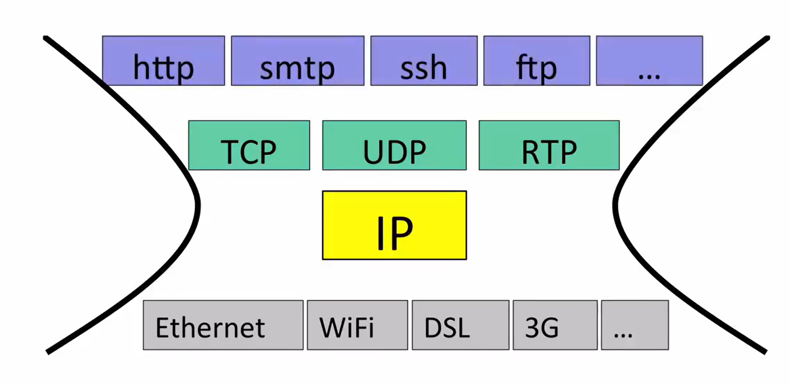
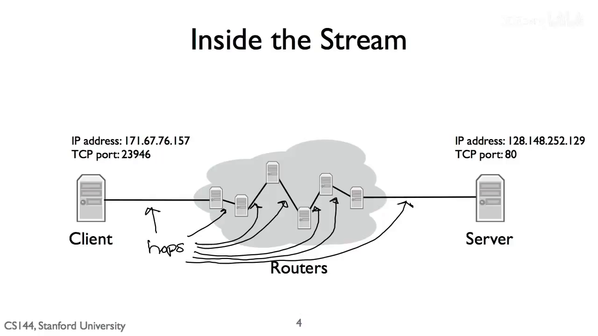

# CS144 第一单元导论

第一单元要回答的核心问题其实很朴素：

> 一台电脑上的应用产生了一串数据，它怎样穿过许多不同的链路和路由器，最后交给另一台电脑上的正确应用？

这一单元出现了 HTTP、TCP、IP、Ethernet、IPv4、ARP 等许多名词，但不必一开始就背协议格式。先抓住一条主线：**应用负责表达数据的意义，端系统负责组织通信，中间网络负责把一个个数据包逐跳送向目标。**

## 1. 从一次网页访问开始

假设浏览器要访问一台 Web 服务器。浏览器先确定服务器的 IP 地址和 TCP 端口，建立 TCP 连接，再发送 HTTP 请求。请求离开电脑前，会被逐层包装成网络能够处理的对象：

```text
HTTP 请求
  ↓ 传输层加入控制信息
TCP segment
  ↓ 网络层加入源、目的 IP 等信息
IP datagram
  ↓ 链路层加入当前一跳的地址信息
Ethernet / Wi-Fi frame
```

这些不是四份互不相关的数据，而是同一份应用数据被一层层装入新的“外壳”。到达服务器后，各层再按相反顺序拆开，最终把 HTTP 字节交给 Web 服务进程。

从操作系统视角看，应用只是通过 socket 文件描述符读写字节；写入成功通常只表示数据进入了内核缓冲区，并不等于数据已经离开网卡，更不等于服务器已经收到。

## 2. Internet 四层模型

Internet 用分层控制复杂度，每一层只承担一类职责：

| 层 | 主要问题 | 常见协议或技术 | 数据对象 |
| --- | --- | --- | --- |
| 应用层 | 这些字节对应用意味着什么？ | HTTP、SSH、BitTorrent | message |
| 传输层 | 怎样把数据交给目标主机上的正确进程？ | TCP、UDP | segment / datagram |
| 网络层 | 怎样跨越多个网络到达目标主机？ | IP | IP datagram |
| 链路层 | 怎样跨过当前这一跳？ | Ethernet、Wi-Fi | frame |



IP 位于中间，像一条“细腰”：上面可以运行许多传输协议和应用，下面也可以使用完全不同的链路技术。只要上下双方都能使用 IP，就不需要让每一种应用分别适配每一种网卡和链路。

分层最重要的不是层数，而是稳定的接口：上层使用下层提供的服务，却不依赖下层内部的具体实现。于是 Wi-Fi 可以换成 Ethernet，浏览器的 HTTP 逻辑通常不需要跟着重写。

## 3. 三个贯穿全课的原则

### 3.1 分组交换：把链路按包共享

Internet 不会为每次通信预先占用一条端到端专线，而是把数据拆成许多可以独立处理的分组。路由器收到一个分组后，只做一个局部动作：

```text
收到分组 → 查看目的 IP → 选择下一跳 → 立即发送或进入队列
```

这样，一条链路可以交替承载许多应用的流量，空闲用户不会白白占着资源，这称为统计复用。代价是多个分组同时争用链路时需要排队，因此时延会变化；队列满时，分组还可能被丢弃。

### 3.2 分层：把职责和状态隔开

路由器不需要理解网页内容，IP 也不需要知道 TCP 如何重传。每层只读取自己负责的首部、维护自己的状态，并向上层提供约定好的服务。这让系统更容易理解、替换和扩展。

分层不是绝对禁止跨层信息，而是要求越层依赖有明确理由。隐藏地依赖另一层的内部细节，往往会让一次局部修改扩散成整个系统的联动修改。

### 3.3 封装：上层对象成为下层载荷


当前层通常只解释自己的头部，把内部内容整体视为 payload（载荷）。链路层不需要理解 HTTP；路由器转发 IP 数据报时，也不需要理解其中是 TCP、UDP 还是别的协议。

最外层的链路帧只在一跳内有效：数据报进入路由器后，旧帧会被拆开；路由器更新必要的 IP 字段，再为下一条链路装入一个新帧。IP 的最终目的地址通常保持不变，而逐跳使用的链路层地址会不断变化。

VPN 展示了封装还可以递归发生：一个完整的 IP 包也能被当作新的载荷，放进另一条加密隧道中传输。不过，封装本身只表示数据的层次关系，并不自动意味着加密。

## 4. IP 提供的是“尽力而为”

IP 的基本对象是 **IP 数据报**。每个数据报都带着最终目的 IP，因此路由器可以独立转发它，不必先为整次通信建立连接。

IP 的服务模型可以压缩成三点：

- **无连接**：发送前不要求网络中的所有路由器建立一条会话。
- **逐数据报处理**：每个数据报可以被独立转发，连续的包不一定走完全相同的路径。
- **尽力而为**：网络会尝试投递，但不保证一定送达、只到一次或按顺序到达。

这不是缺陷，而是清晰的职责边界。全球所有路由器共同实现一个简单的 IP 底座，可靠性、顺序恢复和应用是否真正成功，则由端系统上的 TCP 或应用协议负责。



图中看起来像一条端到端连接，但每台路由器实际上只知道自己的本地转发表和下一跳，没有一台设备掌握这次网页访问的完整进度。

## 5. IPv4 地址怎样帮助转发

IPv4 地址是一个 32 bit 的网络层地址，通常写成 `192.168.0.106` 这样的点分十进制形式。它标识的是网络层端点，不是某个进程，也不是当前链路上的网卡地址。

CIDR 用“地址/前缀长度”描述一个地址范围，例如：

```text
192.168.0.106/24
```

`/24` 表示前 24 bit 是网络前缀，剩余部分用于区分这个子网中的接口。子网掩码 `255.255.255.0` 是同一前缀的另一种写法。判断两个地址是否属于同一子网，本质上是在掩码后比较它们的网络前缀，而不是机械地比较前三段十进制数字。

主机和路由器都要根据目的 IP 选择下一步。路由表中可能有多条规则同时匹配，此时采用 **最长前缀匹配（Longest Prefix Match, LPM）**：

> 先找出所有匹配目的 IP 的路由，再选前缀最长、也就是范围最具体的那一条。


`0.0.0.0/0` 不比较任何地址位，因此能匹配所有目的地址，常被用作默认路由；只要存在更具体的匹配，它就不会优先。

这里必须区分两个概念：

- **最终目的 IP** 写在数据报中，说明数据最终要到哪台主机；
- **下一跳** 是当前设备根据路由表选出的相邻设备，只说明这一刻先交给谁。

路由器通常不会把最终目的 IP 改成下一跳地址。

## 6. ARP 补上“最后一小步”

路由决定了下一跳 IP，但 Ethernet 网卡真正发送帧时，需要的是下一跳网卡的 MAC 地址。ARP（Address Resolution Protocol，地址解析协议）负责完成本地映射：

```text
下一跳 IPv4 地址 → 当前链路上的 MAC 地址
```


如果映射不在缓存中，主机会在本地网络广播询问“谁拥有这个 IP”；拥有该地址的设备再直接回答自己的 MAC。得到结果后，主机缓存映射并发送此前等待的 IP 数据报。

ARP 只在当前链路内工作。若服务器与本机不在同一子网，本机查询的是默认网关的 MAC，而不是远端服务器的 MAC。数据报每经过一个路由器，下一段链路都会重新选择下一跳并使用新的链路层地址。

## 7. 网络上传的是字节，不是 C++ 结构体

协议在线路上规定的是一串确定顺序的字节。多字节整数通常使用大端的网络字节序，而主机内存可能使用小端序，因此程序要在协议边界进行明确转换，例如 `htons`、`htonl`、`ntohs`、`ntohl`。

不要直接把收到的字节缓冲区强制转换为本机结构体：除了端序，还会遇到对齐、填充、对象生命周期和越界读取等问题。更稳妥的做法是先检查长度，再按协议规定的偏移读取字段并转换字节序。

对于导论，记住一句话就够了：**网络协议定义线上表示，编译器和 ABI 决定本机对象表示；二者不能混为一谈。**

## 8. 不同应用为什么使用同一张网络

第一单元用几个应用展示了相同底座上的不同需求：

| 应用 | 主要通信模式 | 关键问题 |
| --- | --- | --- |
| HTTP | 客户端连接固定服务器 | 请求和响应如何在字节流中表达 |
| BitTorrent | 多个 peer 互相交换文件片段 | 如何发现拥有所需片段的节点 |
| Skype 一类实时通信 | 寻找并连接某个特定用户 | NAT 后的设备怎样被通知并建立连接 |

家庭网络常使用 NAT，让多台设备共享一个公网 IP。外部设备通常不能随意向内网主机发起连接，因此实时通信会借助公网 rendezvous（会合）服务器传递“谁在呼叫谁”的控制消息；若双方无法直连，还可以通过 relay（中继）转发实际数据。

这些应用模式差异很大，却都能建立在同一套分层、IP 数据报和链路传输机制之上。这正是 Internet 架构可扩展性的来源。

## 9. 把第一单元压缩成一条因果链

```text
应用产生有意义的数据
    ↓
传输层把数据交给远端进程
    ↓
IP 把传输层对象装入自包含的数据报
    ↓
主机或路由器对目的 IP 做最长前缀匹配，选出下一跳
    ↓
ARP 把下一跳 IP 解析为本地链路地址
    ↓
链路层发送一跳帧；下一台路由器重复上述过程
    ↓
目的主机逐层解封装，把数据交给目标应用
```

以后遇到任何新协议，可以先问四个问题：

1. 它位于哪一层，向上提供什么服务？
2. 它处理的是消息、字节流、数据报还是帧？
3. 当前设备读取哪个首部，又决定最终目标还是下一跳？
4. 丢失、重复、乱序或超时发生后，哪一层拥有足够状态来恢复？

第一单元建立的是 Internet 的整体地图。下一单元会进入传输层，讨论当 IP 只能“尽力而为”时，端系统怎样用确认、重传、窗口和状态机提供可靠的 TCP 字节流。

## 课程材料依据

- AIGC `R066`：*1-12 The Internet and IP Recap*，用于核对第一单元的整体结构与四条主线。
- AIGC `R048`、`R049`、`R051`、`R052`、`R055`、`R064`、`R065`：分别对应四层模型、IP 服务、分组交换、分层、IPv4、最长前缀匹配与 ARP。
- 官方 `R028`：核对 IP 数据报、封装、复用与 best-effort 的职责边界。
- 官方 `R006` 第 1、3--4 页：核对网络接口、下一跳与 ARP；官方 `R007` 第 1、3--4 页：核对路由器与最长前缀匹配。

上述 AIGC 讲义与官方材料在本文涉及的核心概念上没有发现冲突。字节序主要来自 AIGC `1-8 byte order`，官方 Winter 2024 讲义没有直接展开这一主题。
